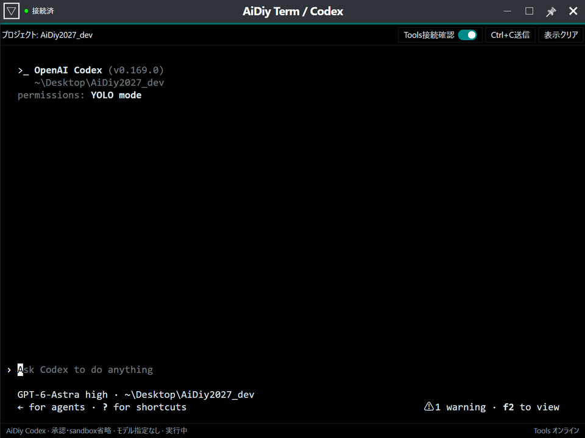
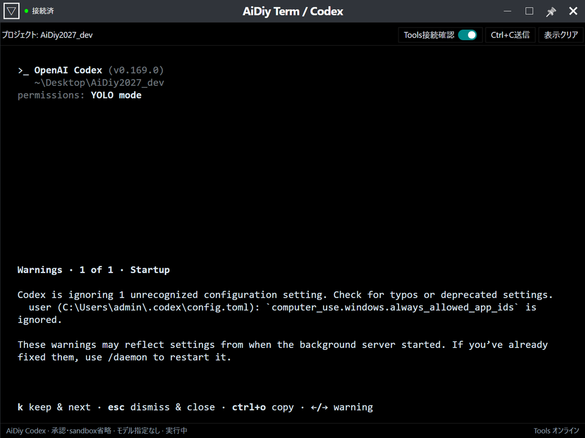
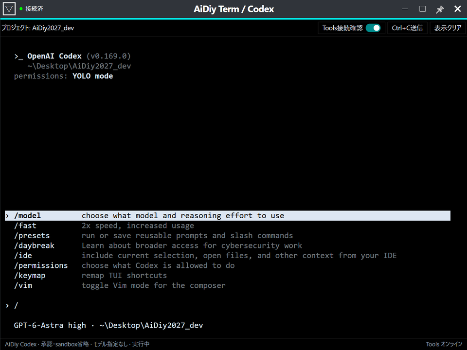
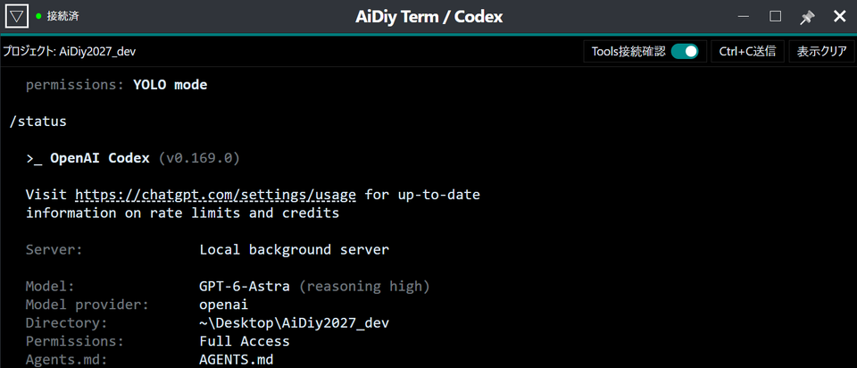
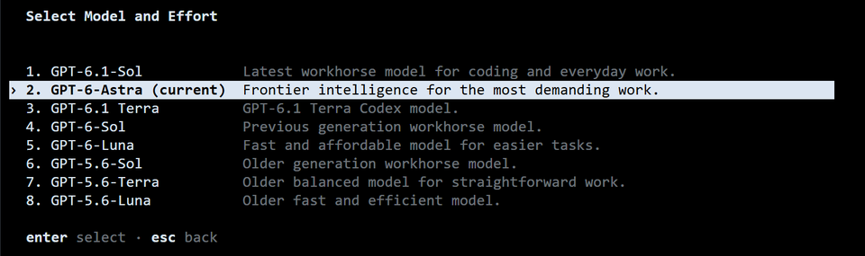
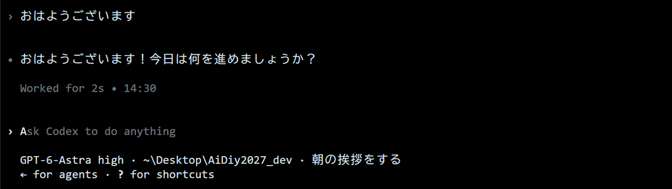
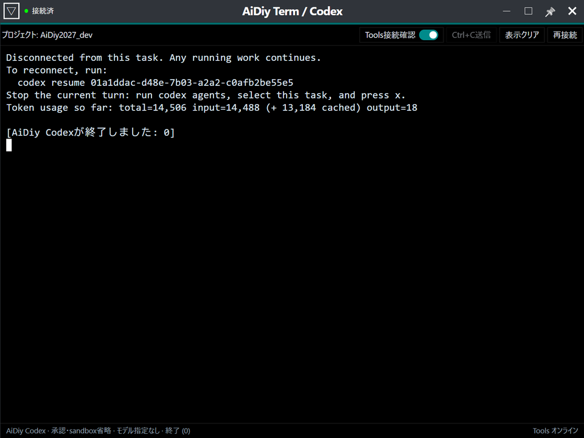
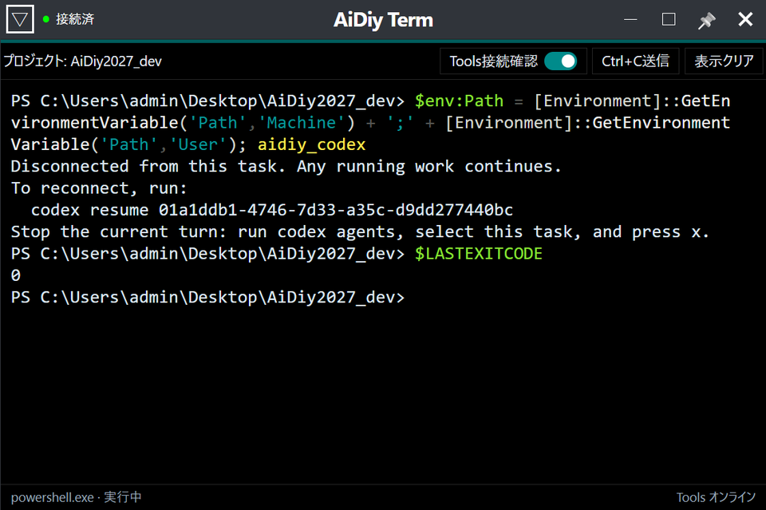

# Codex 操作編 — 操作ガイドとセルフテスト

> 確認範囲：本書はWindows実機の起動・コマンド・会話1回・終了の結果です。今回の実施状況は[確認結果](セルフテスト,共通,確認結果.md)の章別台帳を参照してください。全スラッシュコマンドや別providerの網羅を示すものではありません。

## 総合評価

**✅ OK（起動・読み取りコマンド・会話1回・終了）。** WindowsでDiagからCodexをTerm内で起動し、起動時の警告、コマンド一覧、状態表示、モデル選択画面を確認しました。挨拶を1回送信して返信を受け取り、`/quit` で終了しました。通常のTermから単体の `aidiy_codex` を起動・終了し、終了コード0も確認しました。

[PDF版](セルフテスト,aidiy_codex,操作編.pdf)を参照できます。

## 始める前に

`aidiy_codex` はApache-2.0のOpenAI CodexをAiDiyに同梱し、コンパイルしたCode CLIです。実行ファイルは `~/.aidiy/bin/aidiy_codex.exe` に置かれます。未コンパイルの場合、Diagの「CODEX」は「未導入」と薄く表示されます。セットアップの「aidiy_codex のコンパイル」か `python command_codex/_compile.py` で準備します（release版は時間がかかります）。

Diagで作業フォルダを選びます。起動ボタンの場所は[ランチャー編](セルフテスト,aidiy_diag,ランチャー編.md)、端末共通の操作は[Term操作編](セルフテスト,aidiy_term,操作編.md)を参照してください。Diagからの起動は確認なしで変更を許可する「YOLO mode」です。信頼できるプロジェクトだけで使います。

## 1. 起動

1. Diagの「アプリ起動」で「CODEX」を押します。
2. 「AiDiy Term / Codex」が開いたら、上部のプロジェクト名と接続済み、右下のToolsオンラインを確認します。
3. `OpenAI Codex (v0.169.0)` の見出し、作業フォルダ、`permissions: YOLO mode`、入力欄「Ask Codex to do anything」が出れば入力待ちです。

入力欄の下に使用中のモデル（例：`GPT-6-Astra high`）と作業フォルダが表示されます。

DiagからCodexが起動し、入力待ちになりました。

**図101：Diag起動画面**

右下に「1 warning · f2 to view」などと出た場合は、F2で内容を確認できます。複数あるときは→／←で前後の警告を見て、Escで閉じます。

今回の1件は、利用者設定 `~/.codex/config.toml` の未対応の項目（`computer_use.windows.always_allowed_app_ids`）を無視したという通知です。警告があっても入力はできます。プロジェクトの `AGENTS.md` などの指示ファイルがCodexの読込上限（32,768バイト）を超えた場合も、ここに通知が出ます。

**図102：起動時の警告**

## 2. コマンド・会話・モデル

使える操作を調べるには、入力欄で `/` を入力します。コマンド候補が一覧で表示され、続けて文字を入力すると絞り込まれます。矢印キーで選び、Enterで実行します。

`/` の入力で、`/model` などのコマンド候補が表示されました。

**図201：コマンド一覧**

現在の状態を確認するには、`/status` を入力してEnterを押します。`Model` はモデルと推論の強さ、`Model provider` は接続先、`Permissions` は許可範囲、`Agents.md` は読み込んだ指示ファイルです。設定変更やAIへの依頼は行わない読み取りコマンドです。

この画面の下には、利用アカウントのメールアドレス・ワークスペース・利用残量も表示されます。画面共有や撮影ではその部分を写さないようにします。掲載画像は `Agents.md` の行までです。

**図202：状態表示**

モデルを確認・変更するには `/model` を入力してEnterを押します。モデルの一覧が開き、現在のモデルに「(current)」が付きます。Enterで選択、Escで変更せずに戻ります。

選択画面で候補8件と現在の `GPT-6-Astra` を確認し、Escで閉じました。モデルは変更していません。

AiDiyのモデルは接続区分とモデル名の組で選びます。OpenAIではAPIキーとOAuthが別区分です。推論の強さを選ぶ画面が出る場合は、そのモデルが提示する候補から選びます。通常の Antigravity CLI は `antigravity_cli`、保存済みの Google ログインを使う Agy は `agy_cli` です。 [AGYの導入とモデル一覧の更新](../../_AIDIY/knowledge/backend_server,AGY-Googleログイン運用.md)

**図203：モデル選択**

会話するには、入力欄に文章を入れてEnterを押します。返信は入力欄の上に表示され、処理時間が「Worked for …」で示されます。

「おはようございます」を1回送信し、「おはようございます！今日は何を進めましょうか？」の返信を受け取りました（Worked for 2s）。モデル変更やファイル操作の依頼は行っていません。

**図204：会話**

## 3. 終了

入力待ちで `/quit` を入力してEnterを押します。Term内で起動した場合は、トークン使用量のあとに「[AiDiy Codexが終了しました: 0]」と表示され、上部に「再接続」が出ます。右上の「×」で窓を閉じます。

`/quit` で終了コード0を確認し、「×」で窓を閉じたあと、`aidiy_codex.exe` のプロセスが残っていないことを確認しました。

**図301：Term内の終了**

単体CLIでは、PowerShellなどで作業フォルダへ移動して `aidiy_codex` を実行します。終了は同じく `/quit` で、起動元のプロンプトへ戻ります。

通常のTermで `aidiy_codex` を起動し、`/quit` 後にPowerShellへ戻って `$LASTEXITCODE` が0であること、`aidiy_codex.exe` のプロセスが残っていないことを確認しました。

**図302：単体CLIの終了**

## 証拠照合と残る確認

- **確認済み**：Diagからの起動と入力待ち、起動時の警告（F2）、`/` のコマンド一覧、`/status`、`/model` の表示とEsc、会話1回、Term内と単体CLIの `/quit`（終了コード0）と終了後のプロセス0件。
- **証拠**：[Codex_201 起動・会話・終了](evidence/.aidiy_cache/selftest/セルフテスト,aidiy_codex,操作編/Codex_201_起動会話終了.json)。アカウント情報と会話記録の本文は証拠へ複製していません。
- **気づいた点**：Codex内の表示は上流名のままの箇所があります（見出し `OpenAI Codex`、終了時の再接続案内 `codex resume …`）。AiDiyでの再開は `aidiy_codex resume …` を使います。ルートの `AGENTS.md` は読込上限内に収めています（詳細は各フォルダの `AGENTS.md` へ置き、合計でも上限を超えないようにします）。
- **残る確認・限界**：モデルの切替と復帰、全スラッシュコマンド、別providerでの会話、Mac／Linux実機は未実施です。単体CLIは、利用者PATHを読み直したTermで起動しました（試験用プロセスが古い環境を引き継いでいたため）。
