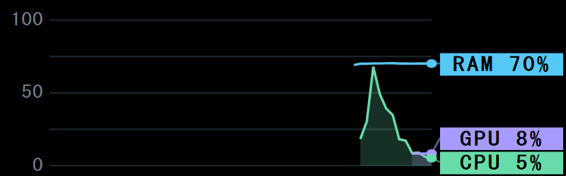

# AiDiy CPU 操作編 — CPU・GPU・メモリーの使用率を見る

## 1. 使用率画面を開く

端末で `aidiy_cpu` を実行するか、Diagの「アプリ起動」で「CPU」を押します。IDEでは利用開始後に「CPU」を選びます。単独画面のタイトルは「AiDiy CPU」、IDEから開いた場合は「AiDiy IDE / CPU」です。Core・Toolsが停止中でも使えます。ブラウザーで開く場合は `aidiy_cpu --browser` を使います。

## 2. グラフを読む

ホスト全体の使用率を約1秒ごとに計測し、直近60回を表示します。縦軸は0～100％、右端が最新値です。

- **CPU（緑の面）** は、最初の測定が終わるとラベルが現れます。
- **GPU（紫の面）** は、取得できない間は線とラベルが隠れます。測定できた0％は「GPU 0%」と表示します。
- **RAM（水色の線）** はメモリーの使用率です。

**図101　Windowsホストを計測した単独CPU画面**

## 3. 背景を切り替えて閉じる

グラフにポインターを重ねるとタイトルバーが現れます。左端の「▽」を押すと背景が透過表示になり、「▷」を押すと通常表示に戻ります。Electronの小窓は右上の「×」、ブラウザー表示はそのタブを閉じます。

## 証拠照合と残る確認

Windowsで単独CPU用のサーバーを立ち上げ、ChromeでCPU・GPU・RAMの実測ラベルの更新、透過・通常表示の往復を確認しました。自動試験ではGPUが取得できない場合と0％の場合、非表示時の採取休止と復帰、単独起動とIDE経由の計測条件を確認しました。macOS・Linux実機、Electronの透過と背後のウィンドウの重なりは今回の確認範囲外です。 [共通の確認結果](セルフテスト,共通,確認結果.md)
