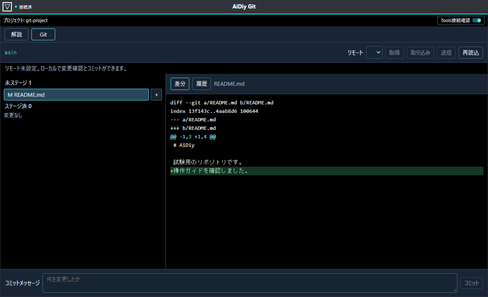

# AiDiy Git 操作編 — 差分と履歴を確認する

AiDiy Gitでは、作業中のファイルの差分を見て、残したい変更を選び、コミットできます。ローカルの試験用リポジトリで主要操作を確認しています。

## 1. 開くリポジトリを選ぶ

1. Gitリポジトリのルートをカレントディレクトリにして `aidiy_git` を実行します。Gitが導入されていない場合や、有効な `.git` がない場合は、端末に理由が表示されます。リポジトリ内のサブフォルダにいる場合は、ルートへ移動して開き直します。
2. Diagの「アプリ起動」で作業フォルダを選び「Git」を押す方法もあります。IDEでは利用開始後の起動メニューから開けます。指定フォルダの直下にリポジトリが複数ある場合は、「リポジトリ」欄から作業対象を選びます。
3. 画面に表示された対象とブランチを確認します。「解説」を押すと、画面の中でも操作手順を読めます。

## 2. 差分を見てコミットする

1. 「Git」タブの「未ステージ」でファイル名を押します。「差分」欄では、変更前の行に赤い「−」、追加した行に緑の「＋」が付きます。本文自体が `--` や `++` で始まる行も同じ色で確認できます。
2. 残したい変更の「＋」を押します。ファイルが「ステージ済」に移ります。選び直すときは「−」を押します。
3. コミットのメッセージを入力し、「コミット」を押します。「履歴」で入力したメッセージを確認します。コミットはまずローカルに保存されます。

ファイルを選ぶと、右側に差分が表示されます。図は試験用のリポジトリです。

**図201：変更一覧と差分**

## 3. 共有先と同期する

| 操作 | 確認すること |
|---|---|
| 取得 | リモートの履歴を取得し、進み・遅れを確認します。 |
| 取り込み | 履歴が直線的に進む場合に反映します。履歴が分岐した場合は止まるので、差分と履歴を確認します。 |
| 送信 | リモート名とブランチを確認して、コミットを共有します。 |

GitHubが取得・送信の両方の共有先になっているときは、PR・Issueタブを利用できます。「強制送信」は共有履歴を書き換える操作です。画面に表示される対象とブランチ名を確認し、最後に確認した共有先の履歴が変わっていない場合だけ実行されます。通常のセルフテストは一時リポジトリとローカル共有先を使います。

## 証拠照合と残る確認

- 隔離試験で差分、ステージと解除、コミット、履歴、取得、早送り取り込み、ローカル共有先への送信を確認しました。分岐時は取り込みと送信を止め、選択したリポジトリの外に操作が及ばないことも確認しています。
- 図は試験用リポジトリを使ったGitパネルです。GitHubへの実送信と、PR・Issueの実データ表示は未実施です。 [セルフテスト確認結果](セルフテスト,共通,確認結果.md#変更箇所の再テスト2026-11-28)
