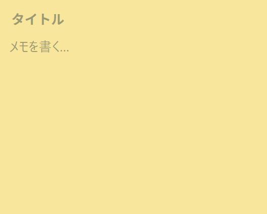
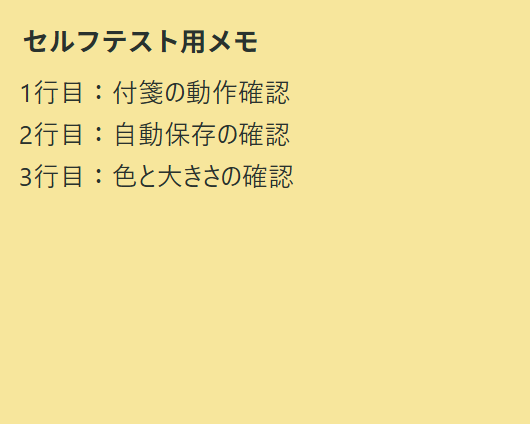
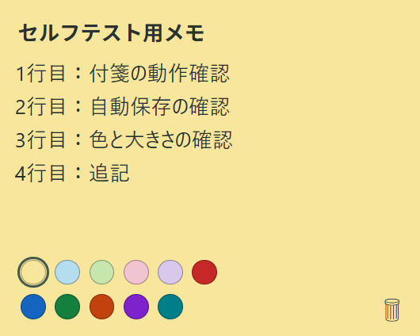
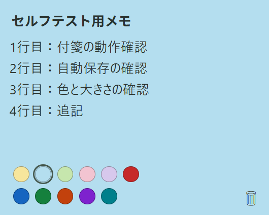
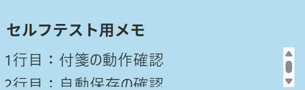
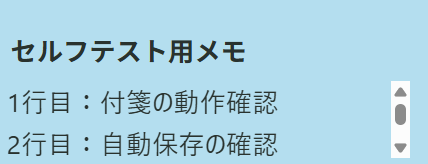
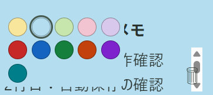
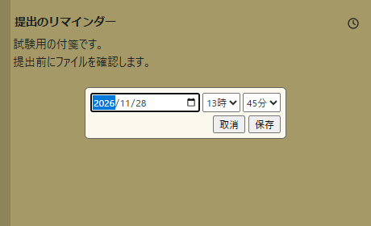
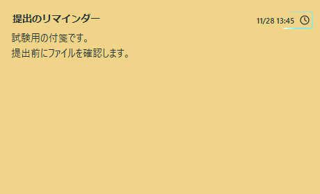

# Memo 操作編 — 操作ガイドとセルフテスト

Windows実機で付箋の作成・保存・色・大きさ・移動・復元・ゴミ箱を確認しました。期限の設定・解除とモーションは、模擬APIを使った隔離Electron試験で確認しました。 [共通の確認結果](セルフテスト,共通,確認結果.md)

## 総合評価

**✅ OK（作成・保存・色・大きさ・移動・復元・ゴミ箱）。** WindowsでDiagから付箋を作り、タイトルと本文を入力して保存されることを確認しました。色・大きさ・位置は変更と同時に保存され、窓を閉じてから `aidiy_memo` で開き直すと、同じ内容・色・大きさ・位置で復元しました。ゴミ箱では付箋が退避フォルダへ移り、通常の一覧から外れました。

[PDF版](セルフテスト,aidiy_memo,操作編.pdf)を参照できます。

実機確認は2026-11-15 14:50の記録（8項目）です。その後、既存の画面7点と記録を照合し、自動・隔離試験を追加しました。追加試験の結果と制約は末尾に記載しています。

## 始める前に

付箋メモ（`aidiy_memo`）はDiagに同梱された付箋です。一覧の窓はなく、付箋1枚が1つの窓で、常に最前面に表示されます。保存先はDiagで選んだプロジェクトの `_AIDIY/aidiy_memo/`（未選択なら起動したフォルダ）で、1枚が1つの `UUID.memo.json` になります。

Diagの起動方法とランチャーは[ランチャー編](セルフテスト,aidiy_diag,ランチャー編.md)を参照してください。

## 1. 付箋を作る

1. Diagのタイトル行の「＋付箋」を押します。ランチャーの「MEMO」や、右クリックメニューの「＋付箋」からも開けます。
2. 「タイトル」「メモを書く…」と表示された空の付箋が開きます。

タイトル・本文・画像・期限がすべて空の新規付箋は、フォーカスを外すと保存せずに閉じます。

**図101：新規付箋**

## 2. 書いて保存する

1. 「タイトル」欄と本文欄に入力します。
2. 入力中は右下に「未保存」と表示されます。
3. 付箋以外をクリックするなどしてフォーカスを外すと保存され、「未保存」が消えます。

タイトルと本文は、入力中はまとめておき、フォーカスを外した時に保存します。書いている途中でアプリを強制終了すると、直近の入力が保存されない場合があります。

タイトル「セルフテスト用メモ」と本文3行を入力し、フォーカスを外した時点で保存ファイルが作られました。保存済みの付箋への追記も、フォーカスを外した時に保存されました。

**図201：入力と保存**

## 3. 色・大きさ・位置を変える

付箋の下の方へマウスを置くと、色の候補（11色）と右下のゴミ箱が表示されます。色を押すと付箋の色が変わり、すぐに保存されます。

**図301：色とゴミ箱**

水色を選び、フォーカスを外さなくても色が保存されることを確認しました。

**図302：色の変更**

大きさは窓の端をドラッグして変えます。縦幅を最小まで縮めても、通常の表示ではタイトルと本文の1行目は全部見え、続きはスクロールで読めます。小さい付箋で色・ゴミ箱を表示すると、操作部分が本文に重なるため、読む時はマウスを外します。付箋の余白（本文の下や下の行の空いた所）を押すと、本文の末尾から入力を続けられます。

**図303：最小の高さ**

移動するには、タイトル欄の上や右の余白、または付箋の縁の色の濃い帯（のりしろ）を押してドラッグします。窓の外周ぎりぎりをつかむと、移動ではなく大きさの変更になります。大きさと位置も変更と同時に保存されます。

見出しの上の余白をドラッグして移動し、位置がすぐ保存されることを確認しました。

## 4. 開き直して復元する

付箋の窓を閉じても、保存済みの内容は残ります。Diagを起動するか、`aidiy_memo` を実行すると、保存済みの付箋が同じ位置・大きさ・色・内容で開きます。

窓を閉じてから `aidiy_memo` を実行し、付箋が最後の状態で復元することを確認しました。ほかの付箋はそのまま残りました。

**図401：復元**

## 5. ゴミ箱へ移す

付箋の下の方へマウスを置き、右下のゴミ箱を押します。最新の内容を保存してから窓が閉じ、付箋のファイルは保存先の `_AIDIY/aidiy_memo/.trash/` の中へ元の名前で移されます。完全には削除されず、次回の起動でも表示されません。戻す場合は、アプリを終了してから、そのファイルを元の保存先へ戻します。

ゴミ箱を押すと窓が閉じ、ファイルが `.trash` の中へ移ったことを確認しました。

**図501：ゴミ箱**

## 6. 期限を設定・解除する

1. タイトル行の時計を押します。「付箋の期限」で日付、時、分を選びます。分は00・15・30・45分から選べます。
2. 「保存」を押すとすぐに保存され、時計の横に期限が表示されます。既存の期限を変更するときは、同じ表示を押します。
3. 期限を消すときは「解除」を押します。「取消」を押すと、開く前の期限を保持します。付箋を開き直し、設定または解除が反映されたことを確認します。

日付・時・分を選ぶ画面です。図は試験用の付箋です。

**図601：期限の設定**

期限15分前から期限表示の枠を光が回ります。期限に達すると枠の回転に加え、付箋全体が明滅します。OSの動き軽減設定を有効にした場合も同じ動作です。図は期限到達後の一場面です。

**図602：期限到達後の付箋**

[日本語音声付きで期限表示を見比べる（MP4）](evidence/付箋期限の実演_20261128.mp4)。同じ付箋の練習用時計を15時14分、15時15分、期限の15時30分へ進めています。最後に「動きを減らす」設定での表示と、時計から「解除」を押した後の本文を確認できます。

## 証拠照合と残る確認

- **実機確認済み**：新規作成、空の付箋を保存しないこと、タイトル・本文のフォーカス離脱時の保存、色・大きさ・位置の即時保存、最小の高さでの表示、窓を閉じた後の `aidiy_memo` による復元、ゴミ箱への退避。
- **証拠**：[Memo_201 付箋の操作](evidence/.aidiy_cache/selftest/セルフテスト,aidiy_memo,操作編/Memo_201_付箋の操作.json)。付箋の本文は試験用の文だけです。
- **追加の自動・隔離試験**：2026-11-15に `node --test frontend_diag/checks/memo-*.check.*` を実行し、85件中81件成功、4件失敗でした。4件はいずれも試験データのシンボリックリンク作成がWindowsの権限で拒否されたもの（`EPERM`）で、リンク保護の確認を完了できていません。成功やスキップには数えていません。[自動試験ログ](evidence/.aidiy_cache/selftest/セルフテスト,aidiy_memo,操作編/Memo_自動試験.log)を参照してください。
- **追加のUI試験**：隔離したElectron画面で、画像貼付・ドロップ・置換・除去、色、保存失敗時の保持と再試行、終了時保存、選択と移動、最小200×84の表示、余白からの入力再開などを確認しました。[UI試験ログ](evidence/.aidiy_cache/selftest/セルフテスト,aidiy_memo,操作編/Memo_UI試験.log)を参照してください。模擬APIを使う試験で、利用者の保存先には書き込んでいません。
- **期限の試験**：隔離Electronで期限の保存・解除、15分前の回転、到達後の回転と明滅を確認しました。通常と OS の動き軽減設定の両方で動作しました。図601・602は現行画面と模擬データで作成しました。 [期限のUI試験](../../frontend_diag/checks/memo-ui-browser.cjs)
- **残る確認・限界**：画像の貼り付け・ドロップ、色の全11種、複数の保存先の切替、Web版、Mac／Linuxの実機操作は未実施です。自動・隔離試験とは区別しています。利用者の既存の付箋には触れず、実機試験用の付箋はゴミ箱へ退避済みです。
