# Navi 操作編 — 操作ガイドとセルフテスト

本書はセルフテスト結果を、操作説明・解説書としても読みやすく整理しています。再テスト後は結果・注意書き・エビデンスを更新し、章立て・操作手順・図解の配置などの様式を維持します。

## 総合評価

**総合判定：確認範囲に限り ✅ OK。全条件の合格ではありません。** 対象はWindowsの単独Electron・IDE別窓・専用Web窓と隔離試験です。実機観測は2026年11月4日〜7日の既存記録、文書・現行ソースの照合は11月7日です。資料の仕上げでは機能試験を再実行していません。

| 確認範囲 | 現在の判定と限界 |
|---|---|
| 起動・窓操作・履歴・モデル・結果表示・コピー・下書き連携 | 既存の実機・隔離記録の条件で確認済み。各章の説明と、当時の記録を区別します。全モデルの認証・利用可否は未確認です。 |
| 専用資料でのナビ・再評価・read-only | 既存記録で確認済み。実プロジェクト全ファイルの不変測定はしていません。達成率はAIの推定であり、テスト合格率ではありません。 |
| 自動航行中のオフ | Code実行中の停止要求と、再評価中のCode表示・非表示の実機確認を区別します。step-8ではオフ後の次のCode要求は0件、受付済み再評価は継続・正常完了。HTTP中断は未観測です。 |
| 過去の模擬7失敗・Hermes期限失敗 | 原記録欠落により原因判定不能のままです。現行見出しの期待値修正・別条件のHermes成功を、過去失敗の解消へ読み替えません（step-9）。 |
| 未確認・対象外 | 実プロジェクトでの自動航行、オンライン／オフラインをまたぐ履歴の実機確認、OS再起動後の復元。Navi自体にVS Code拡張はなく、拡張からの履歴選択も本書の確認範囲外です。Mac／Linux実機・長時間運転はPASS（環境依存・判定対象外）、未実施です。 |

操作の根拠は末尾の「証拠照合と残る確認」にまとめています。図301〜304・401・801・802は既存の結果を現行Vueで表示した説明用の図版です。図901・902はAPIとCodeを模擬した隔離試験の画面です。本文と同名PDFは同じ確認範囲で発行します。最終本文・画像・PDFの対応、参照検証、目視確認は[step-10の照合記録](evidence/Navi資料整合/step-10.json)を参照してください。

## 始める前に

既存term・ユーザー作業は維持し、許可された専用フォルダと試験窓を使います。ナビ・再評価は明示ボタン、または自動航行オン時の評価で実行します。読取専用はファイルの変更を制限し、資料を読むコマンドは利用できます。agentが読んだ本文・検索結果は外部モデルへ送られます。許可された資料以外を送信しません。以下の実プロジェクト分析は、既存記録に残る承認範囲での結果です。資料の仕上げで追加送信はしていません。

常駐Toolsの8095を経由せず、セットアップ済みPythonからCodeAgents／CodeAgent／読取専用CLIを呼びます。Toolsの起動を本試験のために変更しません。

## 1. IDEとDiagから起動する

1. IDE右上の起動メニュー（枠付きの「＋」と、その右の「Console」「Navi」「Code」…）から「Navi」を押します。押した直後は他のボタンと同じく一瞬「起動中…」になって押せなくなり、窓が開くと戻ります。
2. 別窓の「AiDiy IDE / Navi 1」とプロジェクト名を確認します。もう1窓を開き番号2と入力の独立を確認します。
3. Diagのランチャーで、黄色のNAVIアイコンを押します。「AiDiy Navi」が開けば単独起動です。

期待結果：正しいプロジェクトを表示し、別窓の目標・モデル・実行状態が混ざらず、既存termは維持されます。

Diagのランチャー（ミニ表示）でNAVIアイコンを押すと、実プロジェクトのNaviが開きます。タイトル行は、左に状況と「CODE」ボタン、中央にタイトル、右に窓操作です。プロジェクト名と、前回の結果（履歴の最後）が復元され、達成率の色付きバーが並びます。自動航行がオフの間、実AIへの送信は「ナビ」「再評価」を押したときだけです。状況表示の右の「CODE」で開き、「CODE非表示」で隠します。

図101 Naviの単独起動画面

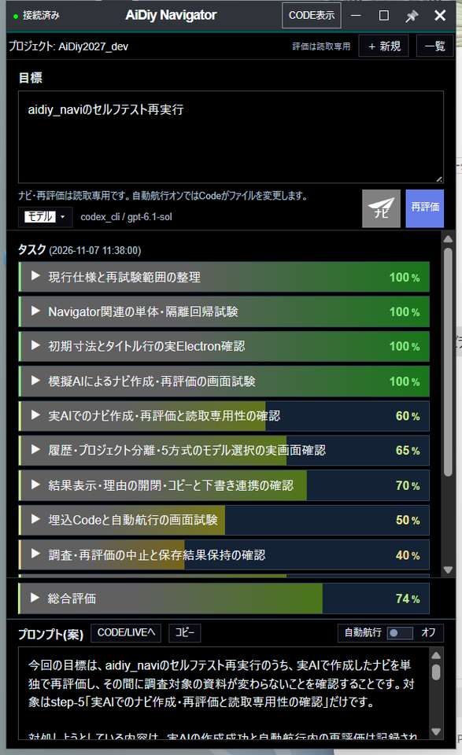

Diagの表示モードとアイコン配置は[ランチャー編](セルフテスト,aidiy_diag,ランチャー編.md)を参照してください。

IDEの上部右側には起動メニューがあります。窓が広いときは、枠付きの「＋」の右に「Console」「Navi」「Code」「Browser」…を横に並べます（各項目に「＋」は付きません）。左上のエクスプローラーと軌跡バーのボタンは、角のある枠の中に2本線（横2本・縦2本）を描いたバーガーです。「＋」も同じ枠・同じ線の太さで描いています。

図104 IDEの起動メニュー（広いとき）

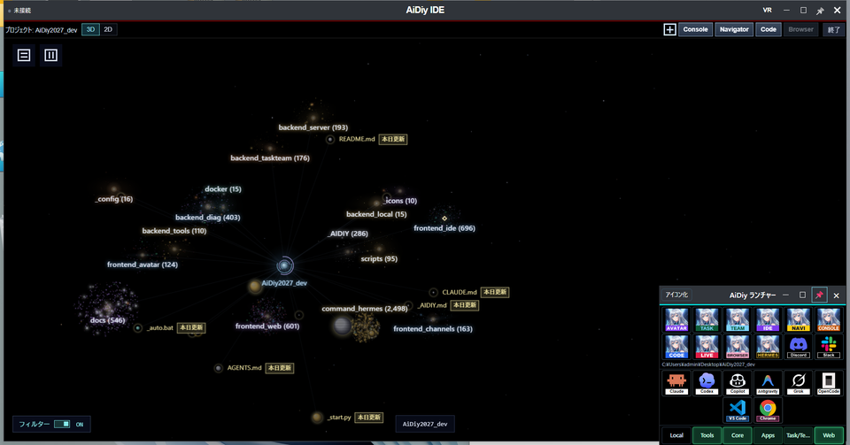

IDEの窓が狭いと、枠付きの「＋」だけを表示します。

図105 IDEの起動メニュー（狭いとき）

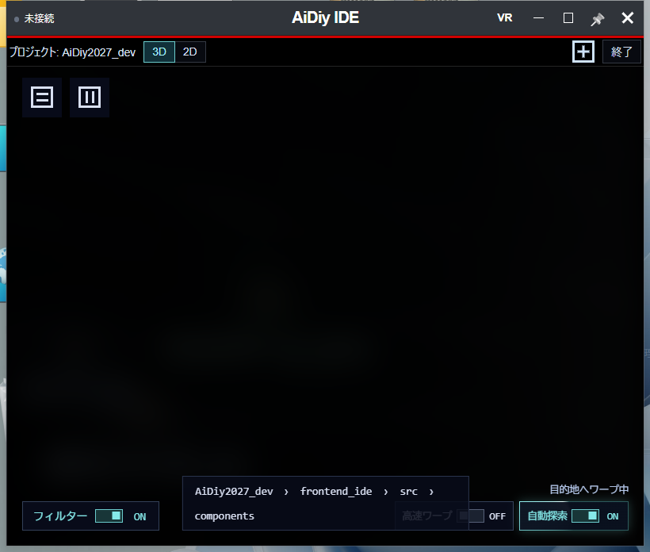

「＋」を押すと、下向きに起動メニューが開きます。Escまたは外側のクリックで閉じます。オフライン利用中は、Toolsが必要な「Browser」は押せません。

図106 起動メニューを開いたところ

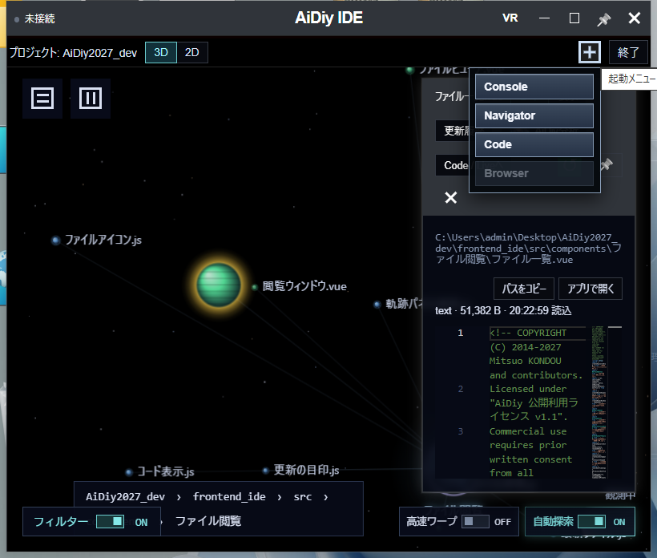

「Navi」を2回押すと、別窓が2つ開きます。それぞれの窓に別の目標を入力しても、互いに影響しません。

図103 ブラウザ版IDEで開いたNaviの2窓

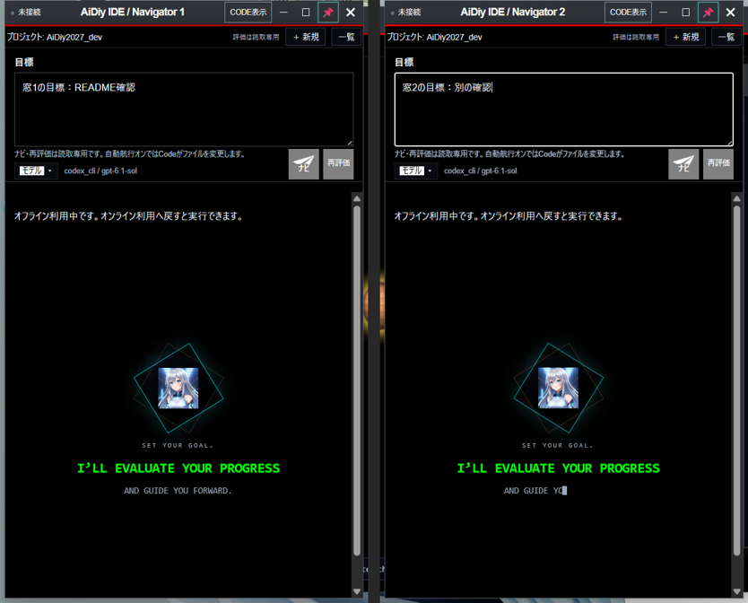

## 2. 単独起動とVR・終了

```powershell
aidiy_navi --project "専用試験フォルダの絶対パス"
```

1. タイトル「AiDiy Navi」、プロジェクト名、目標入力欄の直下のモデル欄を確認します。
2. IDEからの窓は既存のピン・VR操作で配置します。VRから戻っても2窓の入力が残ることを確認します。
3. 片方を通常終了し、もう片方とIDEが維持されることを確認します。

登録済みの `aidiy_navi` コマンドで専用フォルダを指定して起動します。起動直後は、そのフォルダの前回の結果があれば復元されます。タイトル行は、左に「接続済」と「CODE」、中央にタイトル（左右の幅によらず窓の中央）、右に窓操作です。

背景の空いたところを約0.5秒長押しして動かし、離すと終了します（今回は右へ200、下へ100動かし、大きさは変わりませんでした）。Escapeでも解除できます。目標入力欄では移動しません。

IDEのタイトル行右端の「VR」を押すと、IDEが全画面になり、Explorer・軌跡バー・Naviが窓として並びます。VRから戻すには、画面の右上隅へマウスを動かすと現れる戻すボタンを押します（Escでは戻りません）。

VRから戻すと、IDEは元の位置・大きさに戻り、Navi 1・2はそのまま残ります。入力した目標と窓の位置も保たれました。片方のNaviを閉じても、もう片方とIDEは残ります。

Electron版の別窓でもタイトルで対象を識別します。VRの切り替えは[IDE操作編](セルフテスト,aidiy_ide,操作編.md)を参照してください。

## 3. ナビを作り評価する

1. 許可された専用資料のフォルダで目標を入力し「ナビ」を1回押します。
2. 項目・推定達成率・根拠・次のプロンプト案を確認します。
3. 「再評価」を1回押します。現行ソースでは保存済みの目標・項目ID・名前・順序・件数・根拠・工数比率・配分理由を維持し、達成度・総合評価・次の案を更新します。この現在の固定条件はソース照合であり、既存試験を再実行した結果ではありません。
4. 前後のファイル一覧・内容を照合します。結果不明時に再送しません。

専用の赤・青資料ではHermes経由OpenAI gpt-6.1-solによるナビ・評価各1要求が成功し、項目維持とファイル不変を確認済みです。内部モデル呼出し回数とは区別します。実プロジェクトの実装確認結果ではありません。

上部の入力欄は明細をスクロールしても表示され、処理中も次の目標を編集できます。実行中はナビ・評価の再開始を防ぎます。入力が保存済みの目標と異なっても「再評価」は利用できます。押すと最終実行時の目標へ戻して評価します。編集中の別目標を評価するには「ナビ」で新たに作成します。失敗時には前回の結果と編集中の入力を保持します。履歴を選ぶと、その履歴の目標を入力欄へ戻します。

### 専用資料での操作と表示例

ナビ・再評価の既存成功記録は[専用資料の記録](evidence/.aidiy_cache/selftest/セルフテスト,aidiy_navi,操作編/Navigator_301_ナビ評価.json)を参照します。以下はstep-8の公開README確認結果を、現行Vueの単独Web表示で読み込んだ説明図です。API・AI・CLI・保存を使わず、入力前後・調査中・展開・中止通知の表示状態だけを撮影しました。接続状態や新しい処理結果を証明する画像ではありません（[図版の条件と出典](evidence/Navi資料整合/図版.json)）。

1. 目標欄に調べたい内容を入力します。「ナビ」で現在の目標を送ります。空欄のままでは入力を促し、AIを呼びません。

図301 現行部品での目標入力の表示例

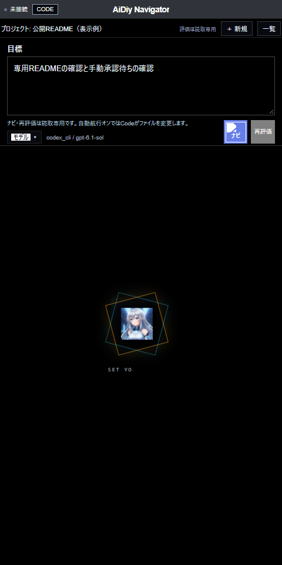

2. 実行中はボタンが「調査中」に変わり、待機画面が出ます。図302は時計を指定した説明用の表示です。待ち時間は対象・モデルによって変わります。

図302 調査中の表示例（処理は実行していません）

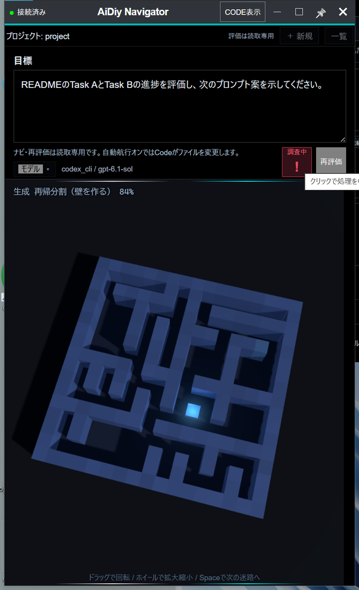

3. 結果の項目と次のプロンプト案を読みます。既存のstep-8結果ではREADME確認100%・手動承認0%・工数比率各50%・総合50%です。

図303 既存結果を現行部品で表示した例

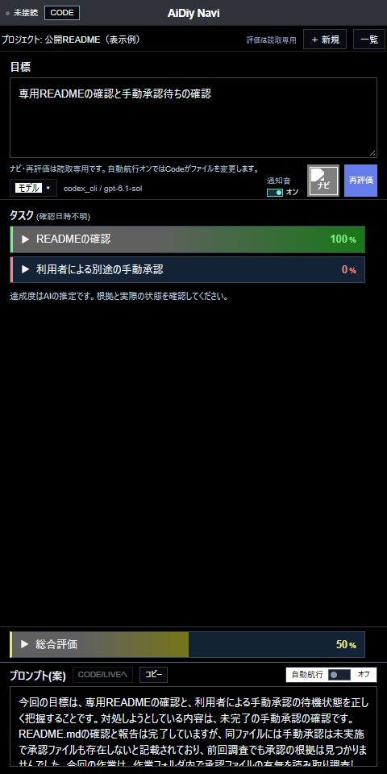

4. 項目名や「総合評価」の左の三角を押すと、根拠と工数比率・配分理由を読めます。再評価では項目の根拠は固定されるため、現在の数値の判断は総合評価の説明も合わせて読みます。

図304 理由と総合評価の展開例

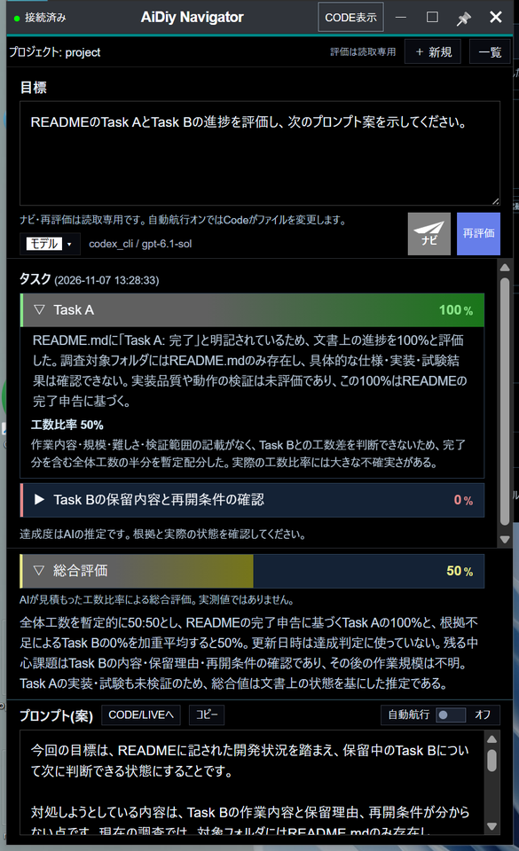

5. 「再評価」を押すと、保存済みの目標で評価します。完了後の読み方は図303・304と同じです。今回、新規の再評価や前後の不変確認は行っていません。

6. 実行中は同じ位置のボタン（ナビは左の「調査中」、再評価は右の「評価中」）を押すと中止を要求できます。サーバーの中止状態を確認してから「処理を中止しました。」を表示し、前回の正常結果を保持します。図801は通知と結果保持の表示例です。自動航行スイッチのオフとは区別します（第9章）。

図801 中止通知の表示例（中止操作は再試験していません）

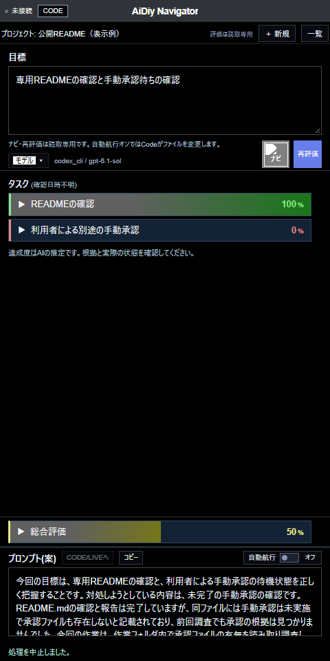

AIの数値は推定で、試験の合格率ではありません。既存の専用資料ではナビ約3分・再評価約1分の記録がありますが、所要時間を保証するものではありません。

### 実プロジェクト分析と初期表示

2026年11月4日（日本時間）、Windowsの専用Web窓で実プロジェクトをread-only分析しました。aidiy_hermes / sameはopenai_oauth/gpt-6.1-solへ解決されました。承認済みの目標指定「Navi機能追加」は13項目の正常結果を取得しました。別窓の未入力ナビは成功し、仮目標・10項目・根拠・次のプロンプトを表示しました。内部モデル呼出し数は未計測で、累計依頼3回（目標指定2回・未入力1回）と同じ数とは断定しません。照合した6ソースの内容は分析前後で一致しました。全ファイル不変を測定したという意味ではありません。

目標指定で13項目・達成率・根拠・次のプロンプトを表示しました。AIの根拠には分析開始時に存在した古い未確認記録も含まれます。後続確認の成功を当時の評価へ遡って反映した数値ではありません。

当時の未入力時は最近の変更から仮目標を推測し、項目別の推定達成率と根拠を表示しました。下へスクロールすると全10項目と次のプロンプトを読めます。agentが未確認とした箇所は、既存のセルフテスト合格を取り消す判定ではありません。

結果原文と判定は[実プロジェクト分析](evidence/.aidiy_cache/selftest/セルフテスト,aidiy_navi,操作編/Navigator_302_実プロジェクト分析.json)に保存しました。初期画面はCodeと同じ開始表示部品を使用し、AiDiyマークと回転する二重四角を表示します。結果作成・履歴選択後は結果へ切り替わります。

モデル候補はDiagがCode一覧から生成する navi_models_info.json を参照し、Naviはread-only対応を確認した `aidiy_hermes`・`codex_cli`・`copilot_cli`・`claude_cli`・`grok_cli` の5方式だけを許可します。Hermesから編集可能な外部CLIへ転送する候補は除外します。Codeの全方式に対応したという意味ではありません。Code本体・認証設定は変更しません。Copilotを含むread-onlyの許可ツール・変更禁止・取消し等の隔離23テストも成功しました。既存の操作セルフテストでは実AI確認を利用可能な方式で行い、各方式の認証や利用枠は判定対象に含めません。

## 4. 履歴とプロジェクト分離

「一覧」で過去のナビを選び、目標・項目を復元します。モデルは今の選択のままで、履歴に残っていたモデルへは切り替わらず、最後の選択の保存も変わりません。「＋ 新規」で新しい目標へ進みます。別プロジェクトの履歴が混ざらず、他窓の選択を変更しないことが期待結果です。履歴の保存・復元・評価による同一履歴更新は隔離試験、一覧操作は実ブラウザで確認済みです。OS再起動を伴う確認はしていません。

実画面では、右上の「一覧」を押すと、このプロジェクトの履歴が新しい順に並びます（右上は「戻る」に変わります）。

図401 保存済み結果を使った履歴一覧の表示例

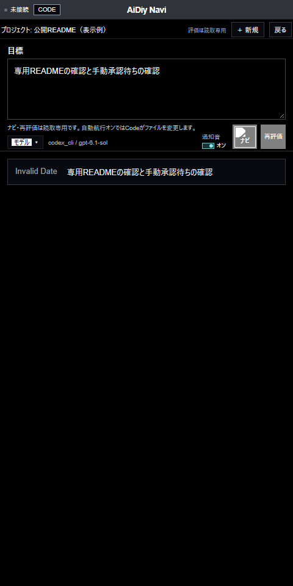

古い履歴を選ぶと、その目標・項目・総合評価が復元され、一覧は閉じます。モデル欄は今の選択（codex_cli / gpt-6.1-sol）のままで、変わりませんでした。

## 5. モデルを選択する

目標入力欄の直下の「モデル」を押し、Codeと共通のダイアログで選択します。未保存時は aidiy_hermes とCode共通設定 CODE_AIDIY_HERMES_MODEL（省略時auto）を使い、保存済みの最後の選択（`~/.aidiy/aidiy_navi_model.json`。Codeの `aidiy_code_model.json` と同じ方式で、Code・Liveの値は変更しません）を優先します。新しく開く窓は最後の選択で始まり、開いている窓どうしは共有しません。保存・再読込と、この独立を確認します。ナビと評価は開始時の選択を使い、実行中は変更できません。読取専用対応providerだけを表示し、Codeの編集権限は引き継ぎません。

実画面では、「モデル」を押すと「コードAIとモデル」のダイアログが開きます。コードAIの候補は、claude_cli・copilot_cli・codex_cli・aidiy_hermes・grok_cli の5方式です。「この窓の選択だけを保存」します。

図501 モデル選択（コードAIの候補）

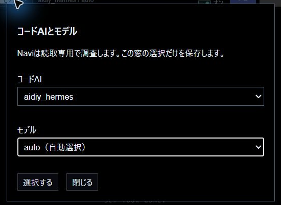

## 6. 達成率の表示

0%・50%・100%の模擬結果を表示します。項目名の背景の幅と数値が一致し、赤→黄→緑が連続変化することを確認します。0%は赤い数値・枠、未実施・未評価は現行の回答検証で0%として集計します。320px幅で長い項目名を折り返し、複数窓の表示を確認します。

500×600当時の模擬AI5要求による専用ブラウザでは、上部入力固定・項目別表示、空入力の定期読込み保持、失敗→再実行、実行中編集保持、履歴切替、複数窓の独立を確認しました。当時の「入力変更→評価無効」は現行仕様ではなく、現在は第3章のように保存済み目標へ戻して再評価します。外部AI送信はありません。0・50・100%、320pxの横はみ出しなしも確認済み。現行ソースでは今回のAI回答の達成度がnullなら0%へ正規化し、保存済み結果の欠損値は補完しません。その他の必須値欠落は拒否します。この規約はソース照合であり、当時の表示試験とは分けます。

実画面では、項目名の背景が達成率の幅で塗られ、色は低いほど赤、高いほど緑になります（0%は赤い数値、100%は緑）。下は履歴から復元した実プロジェクトの8項目で、0〜90%のバーと総合評価（76%）を表示しています。数値はAIの推定です。

## 7. 固定JSON・失敗・read-only

模擬AIで不正JSON、必須値欠落、重複ID、0〜100以外の値、別依頼ID、再評価時の追加・削除・改名・並替・項目の根拠／工数比率の変更を返します。期待結果は拒否と前回正常結果の保持です。タイムアウト、連打、窓終了、プロジェクト利用状態の変化でも古い結果を保存しないことを確認します。

現行の固定形式は schemaVersion=3 / requestId / goal / items（id,name,progress,reason,weight,weightReason）/ overall（progress,reason）/ nextItemId / nextPrompt です。工数比率は合計100、総合は加重平均の四捨五入、次の案は上から最初の100%未満の1項目を対象とします。再評価では達成度以外の項目属性を変更できません。旧形式は自動移行せず「＋ 新規」から再作成します。保存は専用状態領域で行い、AIにプロジェクト内のJSON作成を依頼しません。既存の31件の隔離回帰記録は当時の形式・条件での結果です。現在の追加フィールドを含む全条件を今回再試験したものではありません。読取専用CLIは通常実行へフォールバックしません。

## 8. ナビ中の待機画面

ナビ・再評価の実行中は、表示エリアに待機画面が出ます。通常のクリックでは次の8種からランダムに選び、「夜間飛行」は右クリックのメニューからだけ選べます。

「ナビ」または「再評価」を右クリックすると「ナビの待機画面」が開き、9種から1つを選んで実行できます。「夜間飛行」は一番下に、線で区切って置かれています。

メニューの先頭に「羽衣ライディング」があります。

図710 待機画面の選択メニュー

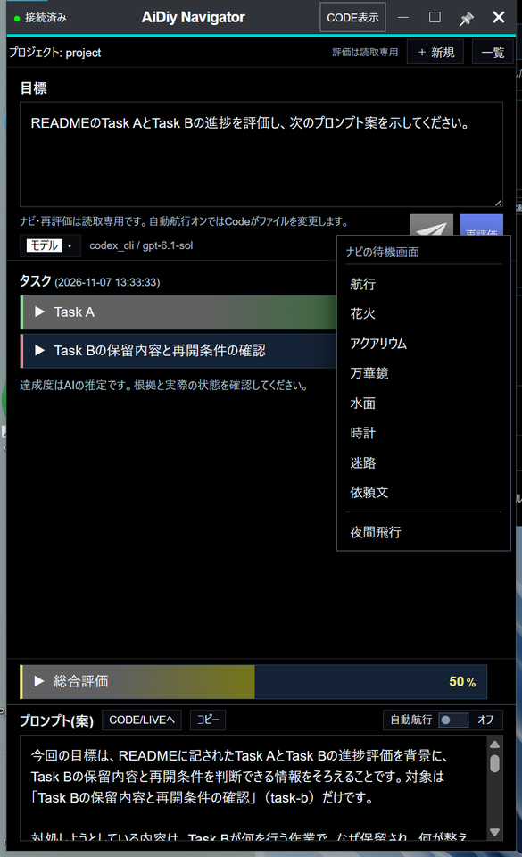

次の9枚は、各待機画面の部品を800×600で単体表示して撮影したものです。撮影は表示完了から15秒後で、花火は30秒後、夜間飛行は45秒後です。画面名のとおりの動きが始まっていれば成功です。

羽衣ライディング：光るバイクが走り、背後に羽衣のような帯が伸びます。左右キーでハンドル、上下キーで加減速し、自分の帯を突っ切ると光と火花が出ます。ダブルクリックで帯を消せます。

図701 羽衣ライディング

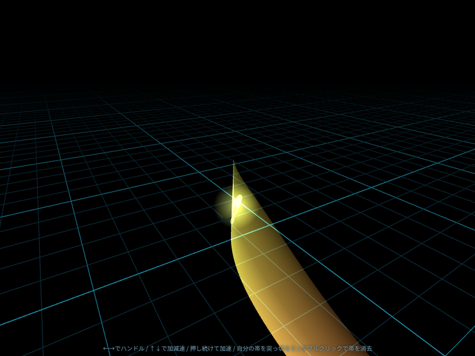

花火：スペースキーを押し続けると大玉を打ち上げます。

図702 花火

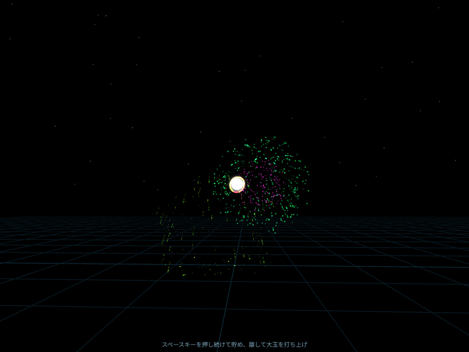

アクアリウム：魚が泳ぎ、クリックした位置から餌を入れられます。

図703 アクアリウム

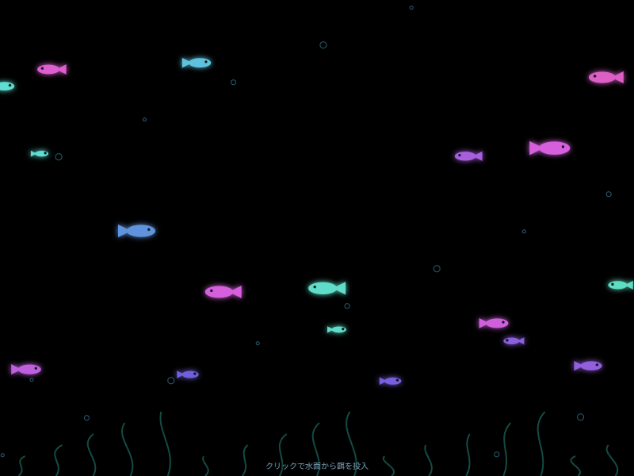

万華鏡：模様が回りながら色を変えます。

図704 万華鏡

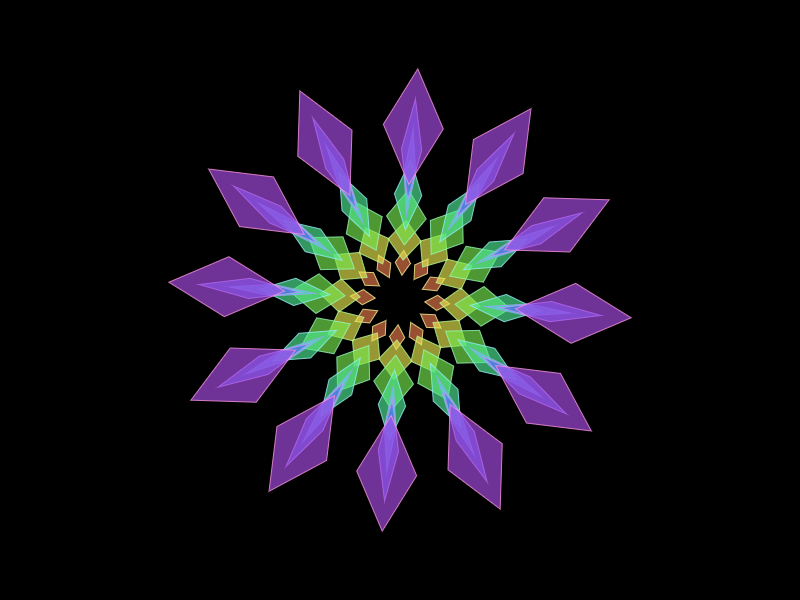

水面：波紋が広がり、スペースキーで波紋を追加できます。

図705 水面

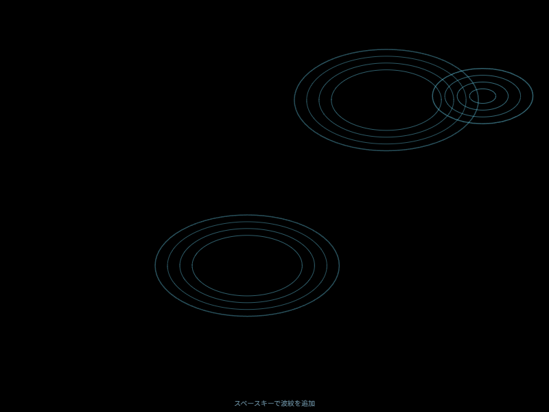

時計：左上に日付、中央に大きく時刻を表示し、数字の色がゆっくり変わります。

図706 時計

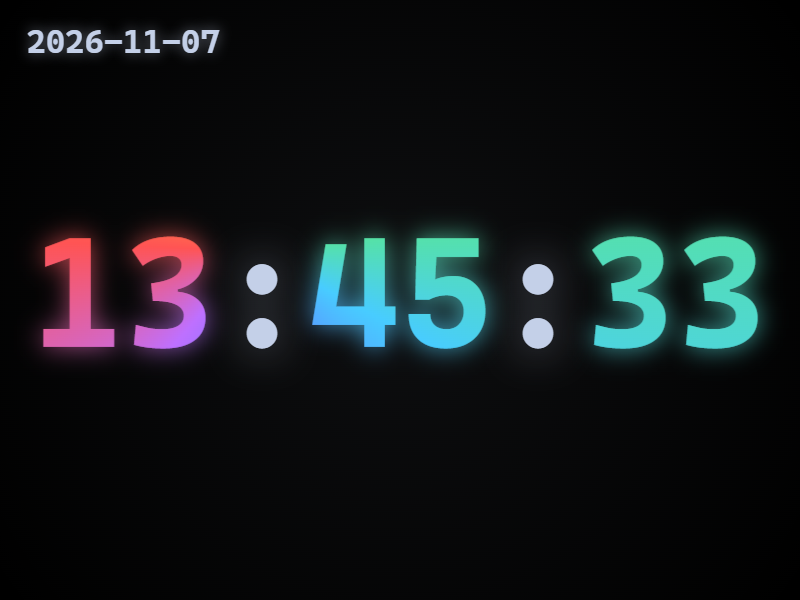

迷路：迷路の生成から解法、答え合わせまでを3D空間で見せます。撮影時は生成の途中です。

図707 迷路

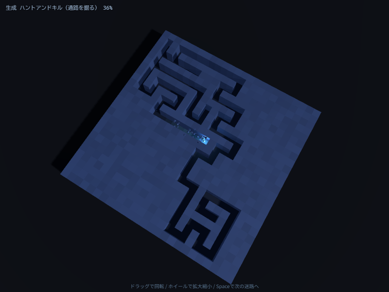

依頼文：プロンプト案を細かく区切り、奥から手前へ流れるコメントとして表示します。この画像は例文を渡して表示したものです。

図708 依頼文

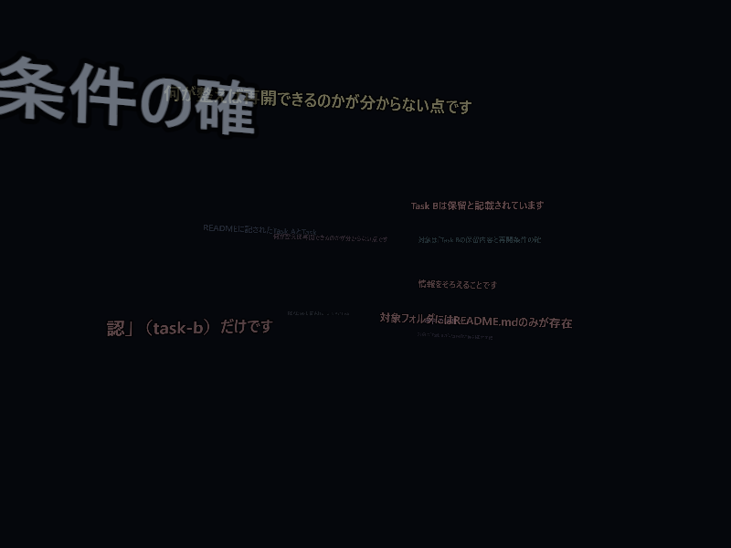

夜間飛行：夜の森林をコックピットから飛びます。起動直後はシステムリカバリーの手順を表示してから離陸します。

図709 夜間飛行

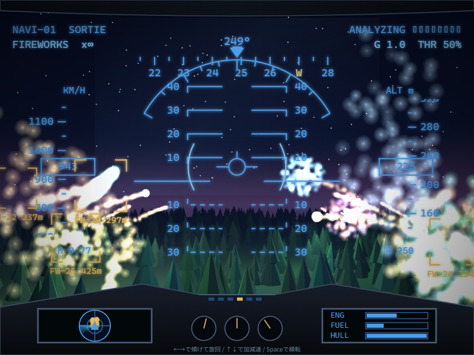

単体表示のため、Navi本体の枠や3行の表示は写っていません。Navi実行中の見え方は、図302の説明用表示（時計）、再評価中の時計、右クリックのメニューから選んだ夜間飛行（下図）で確認しました。夜間飛行は、起動直後のシステムリカバリーの手順が表示され、ボタンは赤い「調査中」になります。ボタンを押すと中止でき、前回の結果は残ります。

## 9. 「コピー」「CODE/LIVEへ」と自動航行

プロンプト(案)の見出しの横には、「CODE/LIVEへ」と「コピー」があります。「コピー」を押すと、プロンプト案がクリップボードへ入り、ボタンが「コピーしました」に変わります。「CODE/LIVEへ」を押すと、同じプロジェクトで起動中のCodeまたはLiveの下書き欄へ追加するダイアログが開きます。起動中の連携先がない場合は「連携先: 未選択」と表示され、「下書きへ追加」は押せません（送信は連携先の画面で行います）。埋込Codeを表示中は現行ソースでは「CODEへ」となり、そのCodeの下書きに追記します。このラベルと経路はソース照合で、今回の資料仕上げでは操作を再試験していません。

図802 CODE/LIVEへ（連携先なし）

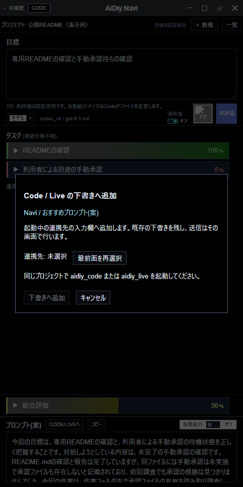

「自動航行」をオンにすると、Naviが右へ広がり、埋込のCodeがプロンプト案を実行してから、完了後に再評価します。タイトルは「AiDiy Navi Cruise」に変わり、下に「自動航行中」「1回目: Codeでプロンプトを実行中…」と表示されます。ファイルを変更し得るため、確認は専用フォルダで行いました（試験後もREADMEのハッシュは変わっていません）。

図901 自動航行オン（隔離試験の表示例）

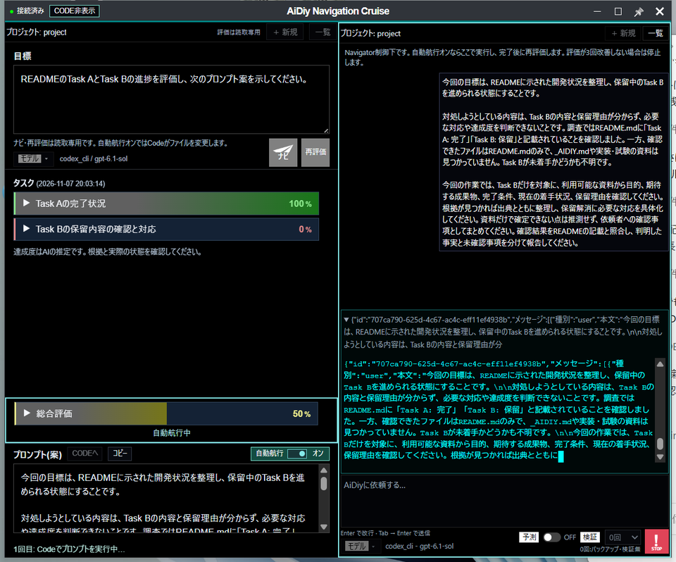

Code実行中にスイッチをオフにすると、「自動航行をオフにしました。実行中のCodeには停止を要求しました。」と表示され、Codeは「処理は強制中断しました」で止まります。

図902 自動航行をオフにしたところ（隔離試験の表示例）

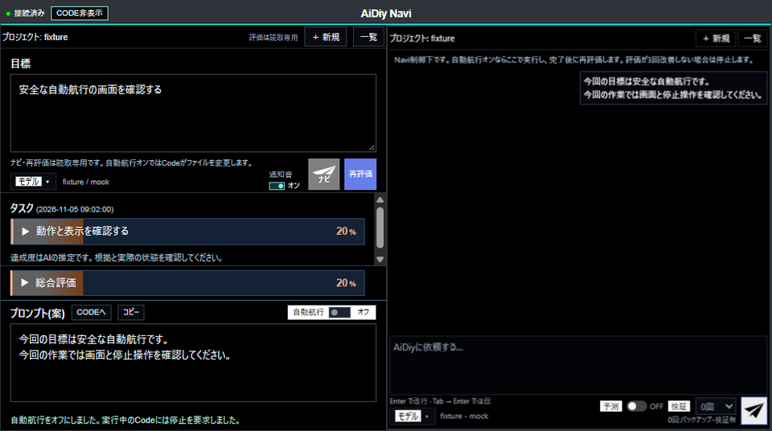

オンのまま3回続けて達成率が改善しなかった場合は、「3回続けて項目の達成率が改善しなかったため停止しました。」と表示して自動でオフになります（今回は3周で止まりました）。

### 再評価中に自動航行をオフにする（step-8）

**WindowsのElectron実機で、Code表示・非表示とも ✅ OK でした。** 専用READMEだけを読むCodeの報告が1回完了し、「1回目: 読取専用で再評価中…」と再評価ジョブの受付を確認してから、「自動航行」を押してオフにします。Codeを隠す条件では、先に上部の「CODE非表示」を押します。オフ直後はタイトルが「AiDiy Navi」に戻り、停止通知が出ます。再評価の待機画面は残り、結果が届くとスイッチがオフのまま再表示されます。

確認条件は2026年11月7日、`codex_cli / gpt-6.1-sol`、秘密情報のない専用フォルダと分離したNavi保存領域です。各条件で接続セッション・プロジェクト一致、Codeの受付・報告・成功、再評価の受付を別々に照合しました。次のプロンプトがある総合50%の結果でも再開しないため、100%による自動終了とは区別できます。根拠は[step-8の照合記録](evidence/Navi停止操作/step-8.json)、[Code表示の要求記録](evidence/Navi停止操作/step8-visible-20261107/electron.jsonl)、[Code非表示の要求記録](evidence/Navi停止操作/Code非表示試験/electron.jsonl)です。

| 条件 | 再評価受付 → オフ確認 → 完了応答（日本時間） | 次のCode要求 |
|---|---|---|
| Code表示 | 20:54:54 → 20:55:03 → 20:55:48 | 0件。完了応答後も約29秒、窓終了まで監視 |
| Code非表示 | 20:58:45 → 20:59:20 → 20:59:24 | 0件。完了応答後も約27秒、窓終了まで監視 |

画面上の停止は、両条件でスイッチの `aria-checked=false` と停止通知を確認しました。HTTP要求の中断イベントは両条件とも未観測です。再評価POSTはオフ前に受付済みで、オフ後も状態取得の通信は継続しています。サーバー側の再評価は中止されず、両方ともオフ後に正常完了しました。自動航行オフは次のCode実行を防ぐ操作であり、再評価ジョブ自体の中止を確認した結果ではありません。

Code表示では、遅れて届いた結果を表示しても右のCodeは1回の報告だけで、スイッチはオフを維持しています。両条件の操作と応答は[照合記録](evidence/Navi停止操作/step-8.json)を参照してください。

Code非表示でも同じ結果です。README確認100%・手動承認0%の結果が届き、次のプロンプトが残っても送信されませんでした。

試験後のREADMEは変更なし、共有サービスの再起動と既存利用者窓の操作は行っていません。停止不具合は再現せず、製品コードの修正はありません。関連する隔離試験22件も成功しましたが、実機合格の根拠は上記の要求・画面記録です。両試験と照合時で停止処理のVueソースは同一です。配布bundleは別経路で更新されており、読込済みJavaScript本文のハッシュは未採取のため、現在の配布物との完全一致は未確認です。試験窓の再読込は行っていません。

## 証拠照合と残る確認

| 順番・項目 | 判定と根拠 | 判定の限界 |
|---|---|---|
| 1 IDE／Diag | 実機確認済み：[起動導線](evidence/.aidiy_cache/selftest/セルフテスト,aidiy_navi,操作編/Navigator_101_起動導線.json) | 同条件の再実行なし |
| 2 単独／VR | 登録cmd起動・通常終了、単独Electron・IDE VRは既存実機記録で確認済み | 現行480×800と旧500×600の実測を区別 |
| 3 ナビ／評価 | 専用資料で実AI成功：[結果](evidence/.aidiy_cache/selftest/セルフテスト,aidiy_navi,操作編/Navigator_301_ナビ評価.json) | デフォルト・目標指定とも成功。実プロジェクト評価の追加送信なし |
| 4 履歴 | 隔離試験・実ブラウザで確認済み | OS再起動試験を後付けしない |
| 5 モデル | 実画面・保存／復元回帰試験で確認済み | 全providerの実AI網羅は対象外 |
| 6 色付きバー | 実ブラウザで確認済み：[表示](evidence/.aidiy_cache/selftest/セルフテスト,aidiy_navi,操作編/Navigator_601_達成率表示.json) | 未評価の描画は実装確認と区別 |
| 7 JSON／read-only | 隔離試験・実AIファイル照合：[実装確認](evidence/.aidiy_cache/selftest/セルフテスト,aidiy_navi,操作編/Navigator_701_実装確認.json) | 読取り内容の外部送信禁止とread-onlyを混同しない |
| 8／9 再評価中の自動航行オフ | Code表示・非表示とも実機確認済み：[要求・画面・サーバー状態の照合](evidence/Navi停止操作/step-8.json) | 次のCode要求は0件。HTTP中断は未観測、再評価ジョブは継続して完了 |

初期の実プロジェクト分析記録にある依頼3回は、その記録の集計です。後続の別試行を含む全期間の累計や内部モデル呼出し数とは扱いません。

### 実行依存が利用できない場合

Naviの起動と履歴閲覧は常駐サービスの稼働で制限しません。Python・選択CLIの実行環境がない場合は理由を表示し、ナビと評価だけを無効にします。待機中は約5秒ごとに再確認し、復帰後は実行できます。実行入口でも依存を再確認します。履歴・前回結果は保持されます。外部AIの認証・利用枠・通信障害は送信を伴う事前診断をせず、実行時に失敗として表示します。

### 現在の検証範囲

依存停止・復帰は模擬依存を使った専用ブラウザの既存確認です。実サービス停止の試験ではありません。実機のナビ・再評価・履歴等の記録は、当時のソース・配布物での確認として扱います。step-8でも読込済みJavaScript本文のハッシュは未採取で、現行配布物との完全一致は未確認です。現行ソースの説明を整えたことによって、実機合格の範囲を広げません。

### 初期サイズと表示

現行の新規Naviは幅480×高さ800論理ピクセルです。小さい画面では作業領域へ収め、既存窓の手動サイズは変更しません。過去の500×600設定での実測・VR復帰は[初期サイズ記録](evidence/.aidiy_cache/selftest/セルフテスト,aidiy_navi,操作編/Navigator_202_初期サイズ.json)に保存されています。旧実測を現行寸法の実測とは扱いません。タイトル中央、右端の窓操作、状況表示右の「CODE」、入力欄直下のモデル欄が現行の配置です。図301〜304・401・801・802の説明図は表示を読みやすくするため480×960で撮影しています。

### Navi専用モデル一覧・入力・接続表示

候補は `_AIDIY/aidiy_diag/navi_models_info.json` から読みます。欠損・破損・旧形式は案内を出し、same/autoと明示入力を残します。候補表示は認証・利用枠の保証ではありません。既定目標は最近の変更を読む指示を実値で表示し、空欄は送信しません。タイトル下の接続バーはTools pingの表示、実行中の往復バーは処理表示です。ナビのローカル実行依存とは別に扱います。

### 既存の基本操作・read-only記録

2026年11月4日の単独・Diag・IDE起動、VR復帰、一覧・モデル選択、専用READMEのHermesナビ・評価は本文に残る既存の実施記録です。実プロジェクトではCodex・Hermesの再評価やAIによる0〜100%の推定値も記録されましたが、その数値を合否の根拠にはしません。Copilotの別途試行のエラーは原因未特定で、全方式の利用成功を意味しません。OS再起動後の復元、実プロジェクト全ファイルの不変測定は未確認です。

読取専用経路・履歴・依存復帰・結果表示の既存隔離記録は[実装確認](evidence/.aidiy_cache/selftest/セルフテスト,aidiy_navi,操作編/Navigator_701_実装確認.json)、専用資料の実AI結果は[ナビ評価](evidence/.aidiy_cache/selftest/セルフテスト,aidiy_navi,操作編/Navigator_301_ナビ評価.json)を参照します。CodexのWindows専用フォルダではread-only sandboxと承認なし、`features.prefer_mxc=true` による読取り・書込み拒否の確認記録があります。他環境や全ファイルの不変性を保証するものではありません。現在の設定を変更して追試はしていません。

### 当時の試験報告と現在の判定の区別

2026年11月6日21時台〜7日7時台の報告には、隔離試験545件・Python11件等の成功、単独起動、Codexのナビ247秒・12項目・総合26%、自動航行2周（26%→44%→60%）、中止・待機画面・モデル保存の確認が記載されています。ただし、当時の参照先 `evidence/_work_records/selftest-20261106/` は現存しません。これらは本文に残る当時の報告であり、原画像・実行ログを現在照合できた結果ではありません。[欠落範囲と判定限界の照合記録](evidence/Navi資料整合/欠落参照.json)へ案内し、原証拠を復元したようには扱いません。

当時は2回目の再評価中に自動航行オフが効かず、3回目のCodeが始まり、窓を閉じたとの報告があります。製品コード・試験スクリプトの変更差分も未レビューとされています。この過去報告の原因や差分を追加調査していません。現在の停止操作の判定は別条件のstep-8（第9章）の実機証拠に限ります。原経過ログは欠落したままで、step-8をその復元として扱いません。

7日の起動・履歴・コピー・連携・複数窓・VR・待機画面の既存実画面は各章に掲載しています。待機画面9種の単体撮影は、ナビ・評価の実AI成功とは別の表示確認です。当時未実施だった再評価は後続の既存専用資料・step-8で確認された条件だけを採用します。オンライン／オフラインをまたぐ履歴の実機確認は未確認のままです。

過去の模擬8本中7失敗とHermes期限失敗は、下記step-9の結論を維持します。

### 残る失敗記録の切り分け（step-9）

**調査結果の判定は完了しましたが、過去の失敗がすべて解消したという判定ではありません。** 元記録の探索範囲、現行の呼出し経路、限定確認の条件と結果は[step-9の照合記録](evidence/Navi失敗切分け/step-9.json)に保存しています。再評価中の自動航行オフ（step-8）は再試験していません。

| 対象 | 判定 | 根拠・不足する証拠 |
|---|---|---|
| 当時の模擬ハーネス8本中7本の失敗 | 原因判定不能 | 元フォルダ、現行の証拠・一時記録・履歴、ローカルGitの2履歴と未参照オブジェクトを探索しましたが、実行一覧・コマンド・期待結果・各出力・終了コードを復元できませんでした。現存する関連スクリプト11本を元の8本と推定して対応付けることはしません。 |
| 当時のHermes／autoの期限失敗 | 原因・停止段階は判定不能 | 記事の期限失敗報告だけが残り、受付応答・要求ID、Python開始、選択後の実モデル、CLI起動・最後の出力・終了コード、期限後の子孫終了記録がありません。Codexの成功や今回の別条件の成功を解消証拠にはしません。 |

現行候補を限定照合すると、`check-navigation.mjs` の「見出し全体が『タスク』と完全一致する」という期待値は、現行の日時付き見出しと不整合でした。既存の日時検証を参考に、この期待値1箇所だけを日時形式の検証へ修正しました。専用フォルダ・分離保存領域・模擬AIの画面で、旧期待値は不一致、修正した期待値は一致しました（[出力と条件](evidence/Navi失敗切分け/現行ハーネス照合/heading.json)）。製品の画面は変更していません。元の7失敗との対応付けも、ハーネス全体の合格判定も行っていません。Windowsでブラウザ実行パスの指定を要する候補もありますが、当時の引数・環境変数がないため、環境原因だったとは断定できません。

Hermesは秘密情報のないREADMEだけを対象に、`aidiy_hermes / auto` のナビを1回だけ限定確認しました。Naviの受付から約76秒で正常完了し、Python入口 → モデル選択 → 読取専用Hermes CLI起動 → 終了コード0 → 結果取得 → NaviのJSON検証・保存までを観測しています。選択後のモデルは `openai_oauth/gpt-6.1-sol`、結果は総合50%で、READMEは変更なしでした（[受付・状態遷移](evidence/Navi失敗切分け/Hermes限定確認/events.jsonl)、[Python・CLI段階](evidence/Navi失敗切分け/Hermes限定確認/python.jsonl)、[結果・条件](evidence/Navi失敗切分け/Hermes限定確認/hermes-result.json)）。製品の読取専用実行を使い、段階・PIDだけを追加観測する試験入口を使用しています。当時の対象・入力・モデル条件を再現できたわけではありません。

期限は別々に扱います。Naviの300秒は準備・走査後のAI実行待ち全体の期限で、到達時に中断信号を送ります。Pythonが渡す280秒はCLIの無出力時間の上限であり、標準出力・標準エラー出力で更新されます。autoのモデル選択もCLI監視開始前に行われるため、単純な20秒の余裕とはいえません。ただし、この違いを過去失敗の原因とは断定できません。実AIを使わない短時間の[終了処理確認](evidence/Navi失敗切分け/期限処理.json)では、無出力時はタイムアウトし所有プロセスが終了、出力が続く場合は合計時間が設定値を超えても正常終了しました。Naviの期限中断1件、読取専用アダプター11件、日時表示1件の関連試験も成功しました。

step-9では、製品不具合は確認しておらず、製品コードの修正・Core／Appsの再起動・既存利用者窓の操作は行っていません。過去の個別判定を進めるには、上表の元の実行一覧と各出力、およびHermesの段階・時刻・終了記録が必要です。今回の限定確認を、それらの欠落した証拠の代わりにはしません。

### 本文・画像・PDFの対応（step-10）

この仕上げは文書・参照・図版・PDFの照合だけです。機能試験、過去失敗の追加調査、実AI送信、Core／Appsの再起動、既存利用者窓の操作は行っていません。現行ソースで確認した再評価の固定条件・入力・JSON規約は操作説明へ反映し、既存の実機結果とは区別しました。

欠落した実機画像フォルダと自動航行の経過ログは、[現存する欠落参照の照合記録](evidence/Navi資料整合/欠落参照.json)に置き換えて案内しています。原記録は欠落したままです。step-9の見出し期待値修正と別条件のHermes成功は、過去7失敗・期限失敗を解消した証拠ではありません。

[PDF版](セルフテスト,aidiy_navi,操作編.pdf)と最終本文のハッシュ、画像出典、全参照の存在・PDFリンク検証、全ページの目視確認結果は[最終照合記録](evidence/Navi資料整合/step-10.json)に残します。PDFの発行は未確認部分の合格を意味しません。
