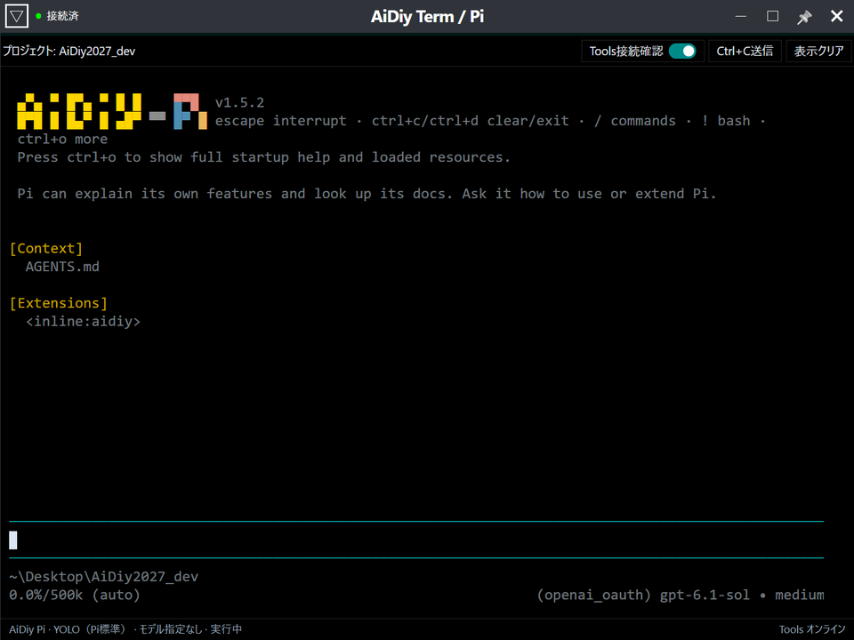
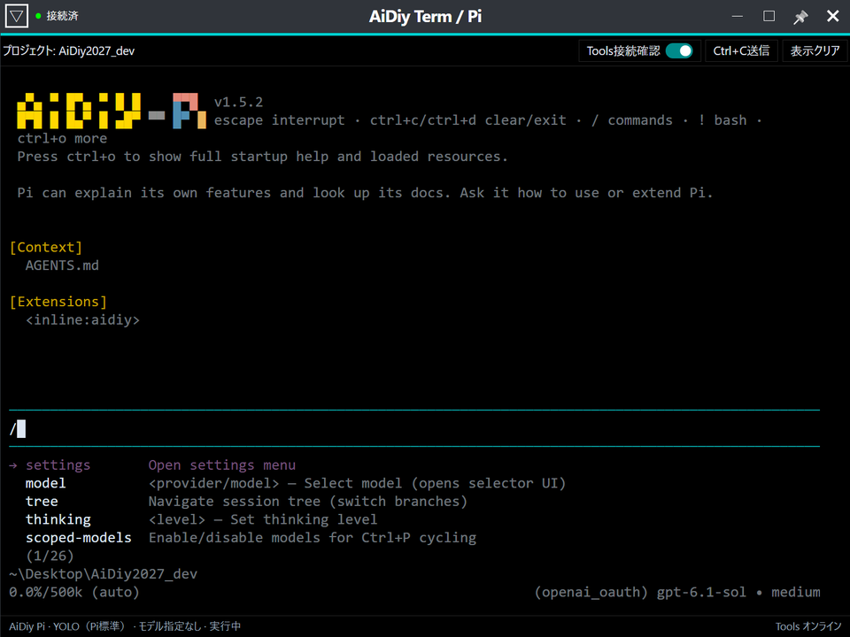
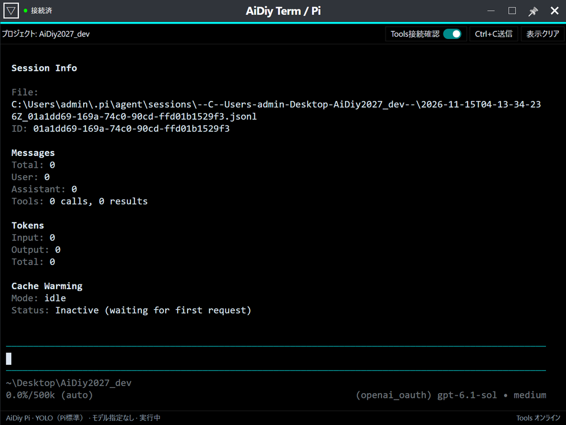
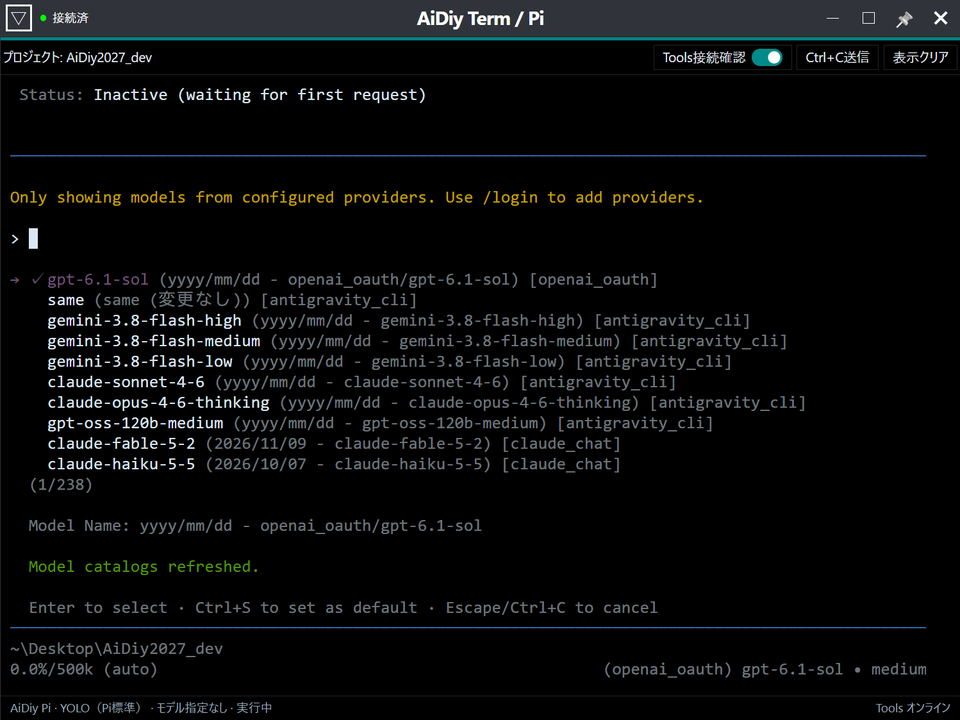
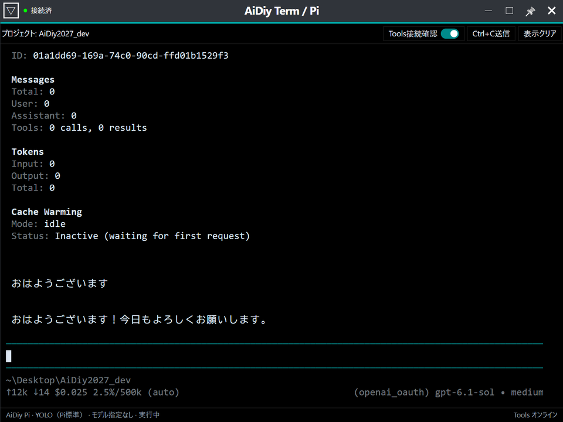
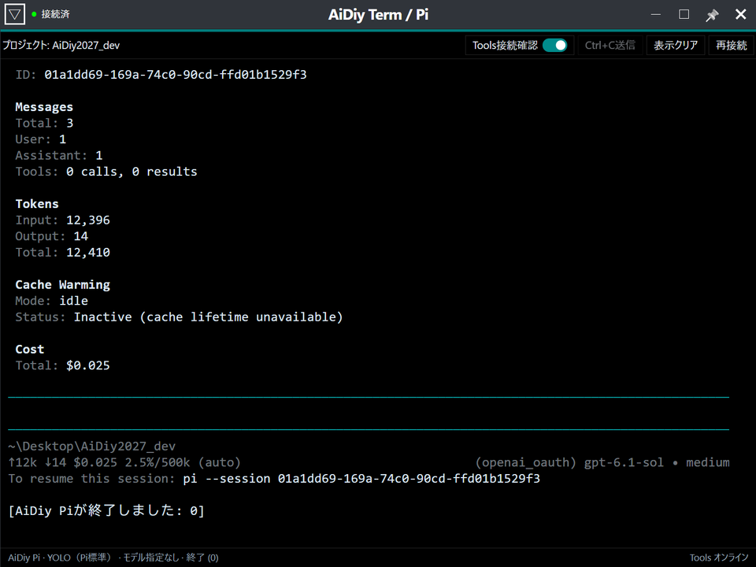
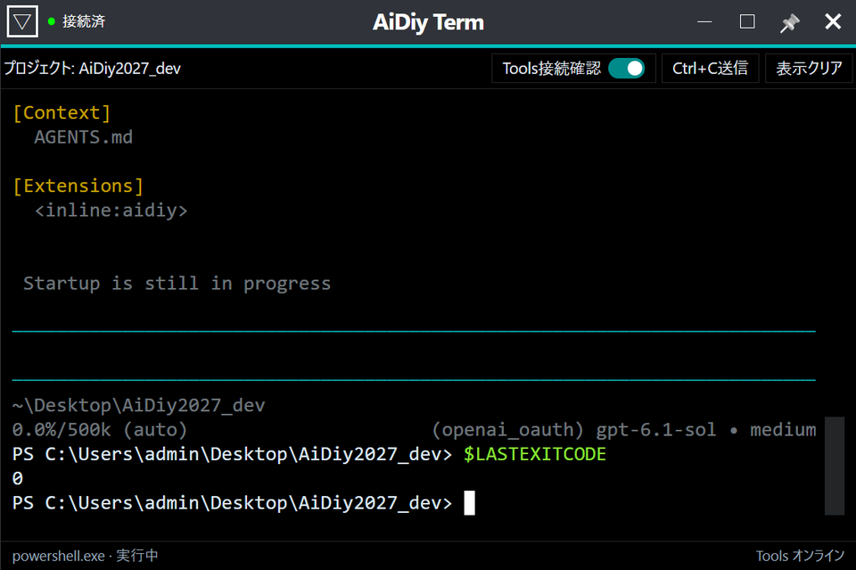

# Pi 操作編 — 操作ガイドとセルフテスト

> 確認範囲：本書はWindows実機の起動・コマンド・会話1回・終了の結果です。今回の実施状況は[確認結果](セルフテスト,共通,確認結果.md)の章別台帳を参照してください。全スラッシュコマンドや別providerの網羅を示すものではありません。

## 総合評価

**✅ OK（起動・読み取りコマンド・会話1回・終了）。** WindowsでDiagからPiをTerm内で起動し、コマンド一覧・セッション情報・モデル選択画面を確認しました。挨拶を1回送信して返信を受け取り、`/quit` で終了しました。通常のTermから単体の `aidiy_pi` を起動・終了し、終了コード0も確認しました。

[PDF版](セルフテスト,aidiy_pi,操作編.pdf)を参照できます。

## 始める前に

PiはMITライセンスのAIエージェント（Pi）をAiDiyに同梱したCode CLIで、Hermesと同じように使えます。Diagで作業フォルダを選びます。起動ボタンの場所は[ランチャー編](セルフテスト,aidiy_diag,ランチャー編.md)、端末共通の操作は[Term操作編](セルフテスト,aidiy_term,操作編.md)を参照してください。

## 1. 起動

1. Diagの「アプリ起動」で「PI」を押します。
2. 「AiDiy Term / Pi」が開いたら、上部のプロジェクト名と接続済み、右下のToolsオンラインを確認します。
3. AiDiy-Piのロゴと版数、`[Context]`・`[Extensions]` の読込表示、入力欄が出れば入力待ちです。

入力欄の下に作業フォルダ、右下に使用中のモデル（例：`(openai_oauth) gpt-6.1-sol • medium`）が表示されます。起動直後に「Startup is still in progress」と出た場合は、起動処理が終わるまで待ってから入力します。

DiagからPiが起動し、入力待ちになりました。

**図101：Diag起動画面**

## 2. コマンド・会話・モデル

使える操作を調べるには、入力欄で `/` を入力します。コマンド候補が一覧で表示され、続けて文字を入力すると絞り込まれます。矢印キーで選び、Enterで実行します。Escで一覧を閉じます。

`/` の入力で、26件のコマンド候補が表示されました。

**図201：コマンド一覧**

現在の状態を確認するには、`/session` を入力してEnterを押します。`Messages` は会話の件数、`Tools` はツール呼出し、`Tokens` は使用量です。`File` と `ID` はPiの会話記録の保存場所と識別子で、認証キーではありません。設定変更やAIへの依頼は行わない読み取りコマンドです。

新規セッションで実行し、Messages 0・Tokens 0を確認しました。

**図202：セッション情報**

モデルを確認・変更するには `/model` を入力してEnterを押します。設定済みの接続先のモデル一覧が開き、現在のモデルにチェックが付きます。Enterで選択、Escまたは Ctrl+C で変更せずに閉じます。

選択画面で候補238件と現在の `gpt-6.1-sol` を確認し、Escで閉じました。閉じた後も右下のモデル表示は変わっていません。

接続先を切り替えたら、モデル名とプロバイダーを確認します。通常の Antigravity CLI は `antigravity_cli`、保存済みの Google ログインを使う Agy は `agy_cli` です。Diagで利用可能なモデル一覧を書き込むと候補に反映されます。 [AGYの導入とモデル一覧の更新](../../_AIDIY/knowledge/backend_server,AGY-Googleログイン運用.md)

**図203：モデル選択**

会話するには、入力欄に文章を入れてEnterを押します。返信は入力欄の上に表示され、右下に使用トークンと料金の目安が出ます。

「おはようございます」を1回送信し、「おはようございます！今日もよろしくお願いします。」の返信を受け取りました。その後の `/session` で User 1・Assistant 1・Tools 0 calls・Tokens 12,410・Cost $0.025 を確認しました。モデル変更やファイル操作の依頼は行っていません。

**図204：会話**

## 3. 終了

入力待ちで `/quit` を入力してEnterを押します。Term内で起動した場合は「[AiDiy Piが終了しました: 0]」と表示され、上部に「再接続」が出ます。右上の「×」で窓を閉じます。

`/quit` で終了コード0を確認し、「×」で窓を閉じて所有プロセスの終了を確認しました。

**図301：Term内の終了**

単体CLIでは、PowerShellなどで作業フォルダへ移動して `aidiy_pi` を実行します。終了は同じく `/quit` で、起動元のプロンプトへ戻ります。

通常のTermで `aidiy_pi` を起動し、`/quit` 後にPowerShellへ戻って `$LASTEXITCODE` が0であることを確認しました。

**図302：単体CLIの終了**

## 証拠照合と残る確認

- **確認済み**：Diagからの起動と入力待ち、`/` のコマンド一覧、`/session`、`/model` の表示とEsc、会話1回（API送信1回・ツール0）、Term内と単体CLIの `/quit`（終了コード0）。
- **証拠**：[Pi_201 起動・会話・終了](evidence/.aidiy_cache/selftest/セルフテスト,aidiy_pi,操作編/Pi_201_起動会話終了.json)。会話記録の本文は証拠へ複製していません。
- **気づいた点**：Pi内の表示は上流名のままの箇所があります（終了時の再開案内 `pi --session …`、`/quit` の説明「Quit pi」）。AiDiyでの再開は `aidiy_pi --session …` を使います。
- **残る確認・限界**：モデルの切替と復帰、全スラッシュコマンド、別providerでの会話、Mac／Linux実機は未実施です。単体CLIは、利用者PATHを読み直したTermで起動しました（試験用プロセスがセットアップ前の環境を引き継いでいたため）。新しく開いた端末では登録済みのPATHで起動できます。
