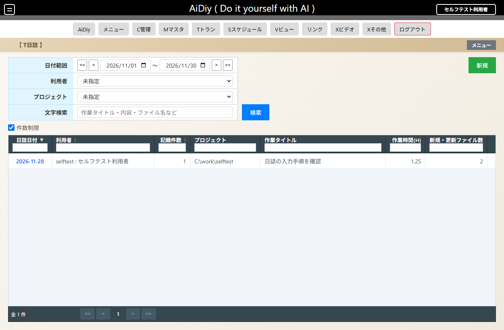
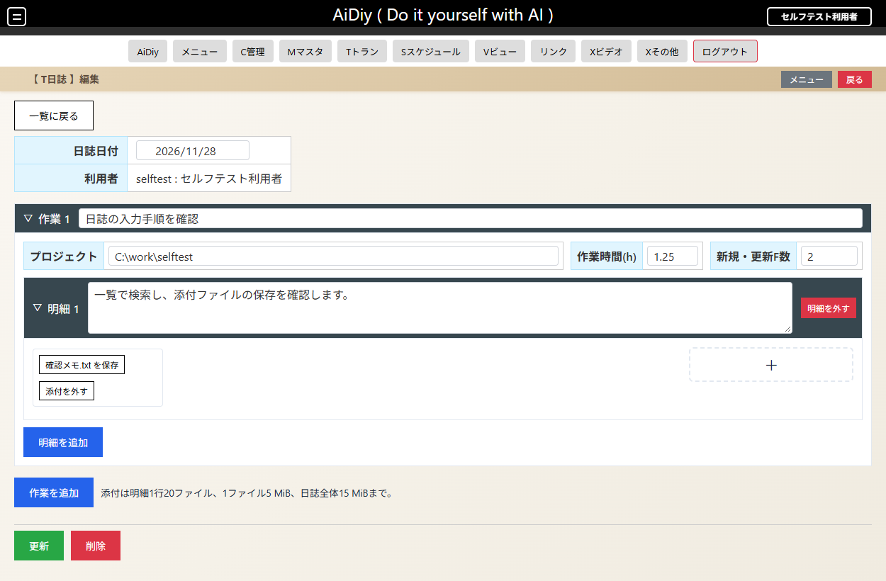

# T日誌 操作編 — Webで作業を記録する

WebのT日誌で、利用者と日付ごとの作業を検索し、作業内容や添付を記録します。API・MCP・日付操作の自動試験31件で確認した結果と、画面例の条件は末尾に記載しています。

## 1. 日誌を探す

1. Webにログインし、上部の「Tトラン」から「T日誌」を開きます。
2. 「日付範囲」、必要に応じて「利用者」「プロジェクト」「文字検索」を指定し、「検索」を押します。文字検索では作業タイトル、明細の内容、添付ファイル名などを探せます。
3. 一覧に表示された日付を押すと、その利用者・日付の日誌が開きます。列名で並べ替え、列の入力欄で一覧をさらに絞れます。

初期の日付範囲は当月です。「≪」「≫」に相当する両端のボタンは前月・翌月の全体を、「＜」「＞」に相当する内側のボタンは前日・翌日の1日を表示します。「件数制限」が有効で結果が上限を超えると、表示件数と総件数が案内されます。

一覧には日付、利用者、作業のタイトルや時間などが表示されます。図は試験データを使った画面例です。

**図101：日誌一覧と検索条件**

## 2. 作業と添付を登録する

1. 一覧で「新規」を押し、「日誌日付」と「利用者」を確認します。同じ利用者・日付の日誌へ作業を追加するときは、一覧の日付からその日誌を開きます。
2. 「作業タイトル」を入力します。「プロジェクト」「作業時間(h)」「新規・更新F数」は必要に応じて入力します。1時間15分なら `1.25` と入力します。
3. 「作業内容」に明細を入力し、必要に応じて添付欄でファイルを選ぶか、ファイルをドロップします。「明細を追加」「作業を追加」で入力欄を増やせます。作業・明細の左側のボタンで内容を折り畳めます。
4. 「登録」を押します。一覧に戻り「日誌を登録しました。」と表示されたら、日付を開き直して内容と添付を確認します。

同じ利用者の1日分に、作業は30件、全作業を合わせて明細は100行まで登録できます。添付は明細1行につき20ファイルまで。空でないファイルを選び、1ファイル5 MiB、1日分の添付合計15 MiB以内に収めます。添付名の横の「保存」でファイルを端末へ保存できます。

作業の欄と、その作業に属する明細・添付の位置を確認できます。図は試験データを使った編集画面です。

**図201：作業・明細・添付**

## 3. 追記・更新・削除する

1. 一覧の日付を押し、編集画面で対象の日付と利用者を確認します。作業を追加したり、既存の記録を編集したりして「更新」を押します。一覧に戻り「日誌を更新しました。」と表示されます。
2. 更新前に別の画面やMCPから変更されている場合は、古い内容での保存を拒否されます。入力を控え、開き直して最新内容を確認してから反映します。「未保存」が出ている間に移動すると、変更を破棄するか確認されます。
3. 日誌全体が不要な場合は「削除」を押します。確認画面の日付と利用者を確認してください。確定すると、その日誌の作業・明細・添付がすべて削除され、一覧に「日誌を削除しました。」と表示されます。作業や明細だけを外すときは、各欄の「作業を外す」「明細を外す」を使い、「更新」で反映します。

## 4. MCPから記録する

`aidiy_dialy_control` はWebと同じ日誌を参照します。利用者IDと日付を指定し、`diary_search` で対象を確認します。作業を追加する場合は `diary_work_create` の返す作業IDを使い、`diary_content_create` で明細を付けます。変更・削除の前には作業IDと行番号を検索し直します。 [日誌MCPの操作と引数](../../_AIDIY/knowledge/backend_tools,構成.md#t日誌の操作)

## 証拠照合と残る確認

- 稼働環境でAppsの日誌API 15ルート、Toolsの日誌MCP 7操作の登録を確認しました。自動試験はApps 24件、Tools 5件、Webの日付範囲2件が合格しました。一時DBで登録・更新・削除、検索、添付、同時更新を確認しています。
- 利用者の依頼に基づき、稼働中のToolsから当日の作業と明細を1件ずつ追加し、日誌検索で保存内容を確認しました。
- WindowsのChromeから、隔離した一時DBと実際のApps APIを使い、新規登録、再表示、添付ファイルのダウンロードと内容一致、更新、削除後の一覧検索まで確認しました。本番の日誌に対するWebからの登録・更新・削除は未実施です。図101・201は模擬APIで試験データを表示した画面です。 [セルフテスト確認結果](セルフテスト,共通,確認結果.md#変更箇所の再テスト2026-11-28)
